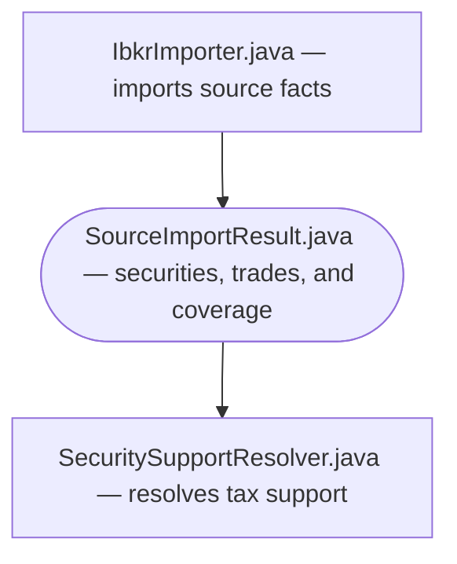

# Tax Calculator product records

Use this skill automatically during active project work. The installed OpenSpec skills own their propose, explore, update, apply, sync, and archive procedures; do not repeat those procedures here.

## Project-specific record ownership

Read `AGENTS.md`, `openspec/config.yaml`, and the relevant active OpenSpec artifacts before changing product records.

| Record | Owns |
| --- | --- |
| `proposal.md` | Scope, purpose, capabilities, and tentative ideas |
| `design.md` | Architecture, decisions, options, and open technical questions |
| `tasks.md` | Progress, evidence, blockers, and dependencies |
| `specs/**/*.md` | Formal requirements and acceptance scenarios |
| `openspec/specs/` | Consolidated requirements after an explicit OpenSpec sync or archive |

Do not create root PRD, tracker, decision, or idea documents. Preserve `R`, `D`, `I`, and task-number identifiers. Keep tentative ideas tentative. Artifact completion and OpenSpec validation do not authorize implementation or prove delivery.

## Diagram format

For architecture or flow diagrams in `design.md`, use Mermaid. Use one visual style for classes that perform work and another for data inputs or outputs. Label working classes with the actual filename and a short responsibility; label data nodes with the data type or result they carry. Show a wrapper pipeline as a Mermaid subgraph containing the classes it coordinates. Start each flowchart with `%%{init: {"flowchart": {"curve": "linear"}} }%%` and use `flowchart TD` so connectors use straight vertical segments. Use Mermaid's default theme; do not add custom colours unless the user asks. For example:

Use plain text only when Mermaid cannot express the relationship clearly. Proposed filenames must be marked as proposed until created. Data nodes do not imply a class that performs work.

### Diagram layout

Keep each flow readable before adding detail. In a top-to-bottom flowchart, declare configuration or reference-data nodes before the working class that consumes them so Mermaid places them to the left where possible. Keep the main processing path vertical. When reconciliation or another later class needs both imported facts and a support result, draw two direct input arrows into that class; do not copy source facts into the support-result node or route them through it. Avoid edges that cross the main processing path, duplicate an existing dependency, or force the reader to trace a curved return arrow.

## Project constraints

- The active delivery changes are planning, not implementation authorization.
- Keep D001–D008 and D010 open until explicitly resolved; keep I007 proposed until explicitly decided.
- Before reporting progress, inspect source and task evidence. A scaffold does not complete a logic task.
- Do not generate tests unless explicitly requested. Preserve the source-code, commit, and push restrictions in `AGENTS.md`.
