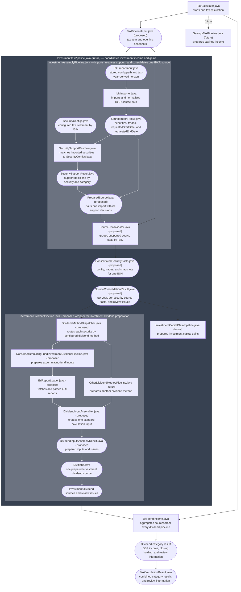
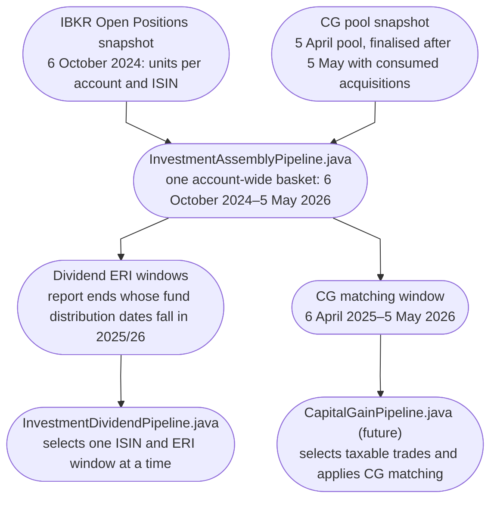

# Design: ACWI dividend run

Planning revision: 7 October 2026. Source: user's request to incorporate the pipeline class redesign discussed on 2 October. The minimal IBKR import boundary was implemented on 7 October at the user's direction. I007 remains incomplete; D001–D006 and D010 retain the unresolved choices below.

## Context

See [proposal.md](proposal.md) for delivery scope and the idea index. The existing design puts security import, configuration lookup, support detection, and dividend assembly under IBKR orchestration. Shared support and dividend preparation should consume provider-independent inputs so another importer can reuse them.

The ACWI run receives account configuration, tax year, CG carry-forward state, and FX data. Its configured IBKR Activity Flex Query supplies security holding snapshots through its Open Positions section. `InvestmentDividendPipeline` fetches and parses the ERI report for each supported security. Existing IBKR extraction, configuration, report parsing, FX, domain calculations, and aggregates are reuse candidates. Reuse does not establish that their current input contracts support account reconciliation or that the full run is working.

## Goals and scope boundaries

- Keep IBKR XML access, field interpretation, and normalization in the provider layer.
- Share configuration lookup, category-specific support resolution, input reconciliation, and dividend assembly.
- Deliver the ACWI path through the existing `TaxCalculator` coordinator and its investment branch.
- Preserve provenance, account context, actual input coverage, assumptions, and artifacts.
- Define shared contracts with future category consumers in mind. CG calculation, pool persistence, savings delivery, other provider implementations, and category-selection UI stay in their existing roadmap changes.

## Proposed architecture — I007 / D010



`TaxPipelineInput` is the shared runtime request. It carries the tax year and CG snapshots; it does not carry provider configuration, credentials, or a manually supplied security holding snapshot. For the initial ACWI delivery, `InvestmentAssemblyPipeline` stores one optional IBKR configuration path plus its `IbkrImporter`, `SecurityConfigs`, executable dividend methods, `SecuritySupportResolver`, and `SourceConsolidator`. It derives the shared import horizon directly from the tax year: 6 October before the tax year through 5 May after it, then creates one `IbkrImportInput`. It also requests an Activity Flex statement ending on the shared earliest dividend boundary, 6 October before the tax year, from a template that includes Open Positions; the imported account/ISIN units form the security holding snapshot. `IbkrApiProvider` partitions a longer horizon into adjacent requests of at most 365 days and returns their raw statements in chronological order. Before issuing requests, it truncates a requested end date to the previous New York weekday because Activity Flex Query data is available only through the previous business day. A wholly future range fails locally; a past `1003` skips only that statement range and becomes a reviewable issue rather than an empty statement. The weekday rule does not model IBKR holidays. A direct Flex request successfully retrieved a 1 December 2025–31 May 2026 report on 14 October 2026, verifying the configured query and explicit-date override. Earlier 1003 responses for older chunks establish only that those statement requests were unavailable; they do not establish a transport range limit. `IbkrTradeMapper` maps that statement list into one combined `TabularDocument`, with one Trades table and one deduplicated Securities table. `IbkrImporter` then extracts securities, trades, and boundary Open Positions once and returns one `SourceImportResult` whose `requestedStartDate` and `requestedEndDate` identify the effective range sent to IBKR. Those dates do not establish complete provider coverage. It does not decide whether a security is tax-supported or which calculations should run. The recoverable `1003` Flex API status becomes a local issue; other Flex API-status failures, retrieval, HTTP, parsing, and extraction failures propagate as exceptions. `SecuritySupportResolver` produces support decisions and review issues from the aggregated import. `PreparedSource` is a tuple-like internal input that pairs unchanged provider facts with its support decision. `SourceConsolidator` groups all supported facts by ISIN and returns `SourceConsolidationResult`; it does not return prepared sources downstream. Each `ConsolidatedSecurityFacts` contains its security, configured tax treatment, all matching source trades, and its imported holding/CG snapshots. `SourceConsolidationResult` also contains the consolidated review issues. Unsupported securities stay outside the calculation input. Duplicate-import, identity-conflict, coverage, and account policies remain under D005/D006/D010. An incomplete source is a review or incomplete outcome, not proof of empty activity. When a second provider is actually onboarded, replace this IBKR-specific edge with user-selected source requests and a provider router; the normalized result, support, and consolidation stages remain unchanged.

`InvestmentDividendPipeline` is the wrapper for investment dividend-method preparation. It passes `ConsolidatedSecurityFacts` entries from `SourceConsolidationResult` to `DividendMethodDispatcher`, which reads each security's configured dividend method and sends it to the matching method-specific pipeline. `NonUkAccumulatingFundDividendPipeline` is the ACWI path: it asks `EriReportLoader` to resolve, fetch, and parse each applicable ERI report before invoking `DividendInputAssembler`. Other investment dividend methods use their own preparation pipeline and do not load ERI reports. Every method pipeline reaches the shared assembler and produces one or more `Dividend` sources plus review issues. The assembler selects only that security's facts in the report's required window. If one pair lacks required coverage, its review outcome does not prevent another fully covered security/report pair from producing a result. Multiple reports for one security run in distribution-date order, carrying each closing holding into the next calculation's opening holding. `TaxCalculator` owns the tax-year `DividendIncome` aggregate and adds the sources returned by each dividend pipeline; pipelines do not retrieve or mutate that aggregate through `Registry`. D002 still decides how the loader finds the report path or URI for an ISIN and tax year.

`IbkrApiProvider` waits 1.1 seconds between adjacent `SendRequest` calls, satisfying IBKR's one-request-per-second pacing rule for the initial two-year import scope. It does not yet enforce IBKR's broader ten-requests-per-minute limit, so a token already rate-limited by other calls can still return `1018`. The provider maps a private `IbkrFlexApiException` at its date-range boundary into a local issue only when the error is recoverable. Error `1003` produces `IBKR_STATEMENT_UNAVAILABLE` at severity `INFO`, then the provider continues with adjacent ranges. Rate-limit error `1018` and every other Flex API failure propagate as exceptions because the import cannot safely continue. The `1003` issue records its failed start date, end date, provider code, and provider message. Network, HTTP, and XML parsing failures also propagate as exceptions because no valid Flex failure response exists to map. `IbkrImporter` places local issues in `SourceImportResult`; `SourceConsolidator` merges them with support issues into `SourceConsolidationResult`. No global registry or issue plumbing through unrelated stages is required.

### Pipeline package layout

Pipeline code is grouped by the stage that owns it. Provider-specific classes live below their provider's importer package; no other stage should depend on an IBKR type.

```text
pipeline/
├── TaxPipelineInput.java
├── assembly/
│   ├── InvestmentAssemblyPipeline.java
├── importer/
│   ├── SourceImporter.java
│   ├── SourceImportResult.java
│   └── ibkr/
│       ├── IbkrImportInput.java
│       └── IbkrImporter.java
├── support/
│   ├── SecuritySupportResolver.java
│   └── SecuritySupportResult.java
├── consolidation/
│   ├── PreparedSource.java
│   ├── SourceConsolidator.java
│   ├── SourceConsolidationResult.java
│   └── ConsolidatedSecurityFacts.java
└── dividend/
    └── future dividend-stage classes
```

### Shared account import horizon

For a full 2025/26 run, `InvestmentAssemblyPipeline` plans one account-wide basket from 6 October 2024 through 5 May 2026. `IbkrApiProvider` first caps its effective end date at the previous New York weekday, then transparently uses contiguous Flex requests of at most 365 days. The pipeline does not choose instruments before importing: it imports account facts, then category pipelines select the required instruments and windows. The dates are a safe shared horizon, not a substitute for validating each ERI report's stated dates.



The IBKR Open Positions snapshot is an account/security quantity baseline: account identity, ISIN, units, timestamp, and source provenance. It replaces a manually supplied `SecurityHoldingSnapshot` for an IBKR source and lets the system reconstruct units held at a report-period end from later movements; it does not need acquisition cost. The accepted snapshot is persisted as a tax-run artifact so a completed calculation remains reproducible even when IBKR no longer makes the historical statement available. A CG pool snapshot is different: it represents the taxpayer's Section 104 state for each relevant security, including quantity and pooled allowable cost. It may also need unresolved matching state for prior disposals whose 30-day window crosses the tax-year boundary; the exact carry-forward contract remains under D007/D010.

For dividends, the system uses ERI reports whose fund distribution date is in the target tax year. The earliest possible report-period end for a 2025/26 fund distribution date is 6 October 2024, six calendar months before the tax-year start. For capital gains, the shared basket extends through 5 May 2026 so a 5 April 2026 disposal can be checked against acquisitions in the following 30 days. A dividend-only run may import a narrower report-derived range; the wider range is the reuse-friendly default when dividend and CG categories run together.

#### ACWI reusable-basket example

The ACWI row below uses State Street's report for the period ended 31 March 2025. The report explicitly states that the fund distribution date is 30 September 2025, so its ERI belongs in 2025/26. Its 1 April 2024 start is inferred from the annual reporting period; source extraction must retain the actual report reference and not assume all funds use this timetable.

| Purpose | Start | End | Extra snapshot or report data |
| --- | --- | --- | --- |
| Shared account facts | 6 October 2024 | 5 May 2026 | — |
| ERI dividends | 6 October 2024 holding boundary | Each eligible fund's reporting-period end | Holding snapshot at the boundary; select each fund by ISIN and ERI report |
| ACWI ERI calculation, 2025/26 | 6 October 2024 | 31 March 2025 | ACWI snapshot at 6 October 2024. Report period: 1 April 2024–31 March 2025; fund distribution date: 30 September 2025 |
| Capital gains | 6 April 2025 | 5 May 2026 | 6 April 2025 Section 104 pool snapshot: quantity, pooled allowable cost, and approved carry-forward matching state |

For example, if the dividend snapshot records 100 ACWI units, the basket records a purchase of 20 units and a sale of 10 units before an illustrative 31 March 2025 report end, the ACWI ERI calculation uses 110 units. The same imported event basket remains available to the later CG change, but that calculation uses its own pool snapshot and date selection.

### Existing pipeline file migration

Names below are proposed contracts. Final signatures depend on task 1.1; no new Java types are created by this planning revision.

| Existing file | Proposed destination | Responsibility change |
| --- | --- | --- |
| `TaxSourcePipeline<I,R>` | `SourceImporter<I>` | Provider-specific import contract: import and normalize source data into `SourceImportResult` without tax-category decisions. |
| `ibkr/IbkrTaxSourcePipeline` | `ibkr/IbkrImporter` | Coordinate IBKR provider calls, parsing, security extraction, and transaction normalization. Remove tax support checks, reconciliation, and dividend assembly. |
| New shared coordinator | `assembly/InvestmentAssemblyPipeline` | Derive the shared IBKR horizon, import one configured source, resolve support, and consolidate results for category pipelines. |
| `ibkr/IbkrPipelineInput` | `importer/ibkr/IbkrImportInput` and `TaxPipelineInput` | `InvestmentAssemblyPipeline` creates one `IbkrImportInput` from its optional stored config path and tax-year-derived horizon. `TaxPipelineInput` owns tax year and opening snapshots. `IbkrApiProvider` hides its request-size limit. |
| `ibkr/IbkrPipelineResult` | `SourceImportResult` | Replace `extractedDividends` calculator inputs with imported securities, trades, `requestedStartDate`, and `requestedEndDate`. The dates record the request; they do not prove coverage. |
| `ibkr/IbkrSupportedSecurityExtractor` | Split between `IbkrImporter` and `security/SecuritySupportResolver` | Keep fetching/extraction provider-specific; move configuration matching and support decisions into `InvestmentAssemblyPipeline`. |
| `ibkr/result/IbkrSupportedSecurityExtractionResult` | `security/SecuritySupportResult` | Describe support per category, with reasons and source references. |
| `ibkr/dividend/IbkrDividendExtractor` | `dividend/DividendInputAssembler` | Assemble dividend calculation inputs from shared normalized facts, validated report/opening state, and rates. |
| `ibkr/result/IbkrDividendExtractionResult` | `dividend/DividendInputAssemblyResult` | Carry assembled dividend inputs and preparation issues. |

### Method ownership in the supported-security split

- `importIbkrFlex(...)`, `createApiProvider(...)`, and the call to `IbkrSecurityExtractor.extractSecurities(...)` move into `IbkrImporter`.
- `InvestmentAssemblyPipeline` receives `SecurityConfigs` once for the run and supplies it to shared support resolution.
- `detectSupportedDividendSecurities(...)` and `detectSupportedDividendSecurity(...)` move to the support-resolution step within `InvestmentAssemblyPipeline`, with category-specific decisions rather than a single supported/unsupported instrument flag.
- `unsupportedInstrumentIssue(...)` moves with support resolution and receives real source/account references instead of hardcoding IBKR.
- Retain all imported securities for review and other consumers. Unsupported dividend configuration must not silently remove facts from the shared input collection.

### Shared contracts and behavior

| Component | Inputs → outputs | Side effects, validation, and errors |
| --- | --- | --- |
| `SourceImporter<I>` / `IbkrImporter` | Provider configuration and an explicit requested date range → `SourceImportResult` | File/network I/O; `IbkrApiProvider` caps the effective end at the previous New York weekday and the result records that effective range. Credentials remain local. Retrieval, API-status, parsing, and extraction failures are fatal in the initial implementation. Do not load security tax configuration or construct category-calculation inputs. |
| `InvestmentAssemblyPipeline` | `TaxPipelineInput` → `SourceConsolidationResult` | Derives the initial combined dividend/CG horizon directly, then coordinates the configured `IbkrImporter`, support resolution, and `SourceConsolidator`. The provider hides Flex request partitioning and returns a local issue for unavailable `1003` statement ranges. Category pipelines receive its output rather than raw importer results. Other provider retrieval failures propagate. A provider router is deferred until a second provider is onboarded. |
| `TaxPipelineInput` | Tax year and CG carry-forward state → shared runtime request | Data only. The first IBKR version obtains the security holding snapshot from the configured Activity Flex Open Positions section at the shared earliest dividend boundary; category selection and account ownership remain under D010. |
| `SourceImportResult` | Imported securities, trades, local provider issues, boundary holding snapshots, and requested start/end dates | Data only. Boundary snapshots come from Activity Flex Open Positions. The result does not claim complete source coverage or attach per-trade account provenance; those remain under D010. It retains a provider's non-fatal unavailable-range issues; support resolution and later preparation add their own review issues. |
| `SecuritySupportResolver` | Securities from one `SourceImportResult`, loaded configs, and the set of executable dividend methods → one `SecuritySupportResult` | No broker I/O. The result contains supported securities/configuration and distinct review issues for missing configuration, an explicitly unsupported method, or a configured method absent from the executable set. `InvestmentAssemblyPipeline` keeps the associated import facts for reconciliation. Configured metadata alone must not advertise executable support. |
| `PreparedSource` | One `SourceImportResult` plus its `SecuritySupportResult` → paired consolidator input | Data only. Preserves the relationship between provider facts and support decisions while consolidation runs; it is not returned to category pipelines. |
| `SourceConsolidator` | `List<PreparedSource>` and `TaxPipelineInput` → `SourceConsolidationResult` | In-memory consolidation. For each supported ISIN, combine matching imported trades with its config and holding/CG snapshots into one `ConsolidatedSecurityFacts`. Combine issues from every `SecuritySupportResult`, retaining one of each logical issue identified by code, source, and attributes. Do not include unsupported securities. Duplicate-import, transfer, identity-conflict, coverage, and account policies remain under D003/D005/D006/D010. |
| `SourceConsolidationResult` | Tax year, `List<ConsolidatedSecurityFacts>`, and `List<Issue>` → category-pipeline input | Data only. It is the consolidated result for the tax run and keeps non-fatal source-assembly review issues for later result aggregation. `Issue` is the application-wide non-fatal condition type: its code, severity, source, and attributes identify the issue without tying it to a tax category or pipeline stage. |
| `ConsolidatedSecurityFacts` | Security, config, trades, holding snapshots, and CG snapshots for one ISIN → per-instrument category input | Data only. All facts are scoped to this instrument; a category pipeline selects only the fields it needs. |
| `InvestmentDividendPipeline` | `SourceConsolidationResult` and FX → dividend results, artifacts, and preparation issues | Wrap `DividendMethodDispatcher`, all method-specific preparation pipelines, shared input assembly, and `DividendIncome`. Coordinate calculations in distribution-date order. Avoid counting preparation and dividend computation as separate income events. |
| `DividendMethodDispatcher` | Supported securities/configurations → method-specific preparation pipeline | In-memory routing only. Select the configured executable dividend method for each security; unsupported or unimplemented methods remain review outcomes rather than being sent to an unrelated pipeline. |
| `NonUkAccumulatingFundInvestmentDividendPipeline` | Accumulating-fund security/configuration and shared facts → `DividendInputAssemblyResult` records | Coordinates only the `NON_UK_ACCUMULATING_FUND` path. Uses `EriReportLoader`, then passes each selected security/report pair to the shared assembler. |
| `EriReportLoader` | Supported security configuration and tax year → parsed `AccumulatingFundReport` records with provenance | Network/file I/O. Resolve each report path or URI, fetch and parse it, and validate it belongs to the configured ISIN before returning it. D002 defines the source lookup rule and the outcome when a report cannot be found. |
| `DividendInputAssembler` | Relevant normalized movements, report, opening holdings, rates, tax year → `DividendInputAssemblyResult` | No broker access. Validate security/report identity, distribution year, opening boundary, movement coverage, and required FX before constructing domain inputs. |
| `TaxCalculator` | Run request → `TaxCalculationResult` | Own shared initialization, invoke `InvestmentAssemblyPipeline`, and run category pipelines. Merge issue provenance without hiding partial or fatal outcomes. |

`SourceConsolidationResult` is a typed collection of per-instrument facts, not a single Section 104 pool. `ConsolidatedSecurityFacts` groups matching facts by ISIN but does not deduplicate provider records or blindly sum account-level CG snapshots. Retain `Registry` for shared run resources such as FX documents. Provider/account context must accompany trade IDs before duplicate-import and transfer policies can be implemented.

### Reuse and later consumers

Retain `IbkrApiProvider`, `IbkrTradeMapper`, `IbkrSecurityExtractor`, and `IbkrTradeExtractor`. The extractor reads raw IBKR trade fields directly: `isin`, `transactionID`, `tradeDate`, `buySell`, `quantity`, `proceeds`, and `ibCommission`. It skips non-security rows without an ISIN and currently accepts only GBP rows; D004 still defines future FX normalization, rounding, and provenance for other currencies. Retain `SecurityConfigs`, `SecurityConfig`, report-format-specific ERI extraction, FX services, and dividend domain models/aggregates, subject to input-contract checks.

The later `CapitalGainPipeline` builds final `TradeBook` instances from relevant combined account transactions before invoking CG calculations. `IbkrTradeBookExtractor` can remain a source-local helper, but does not own that final grouping. The later `SavingsPipeline` consumes normalized cash inputs. These classes are architectural consumers, not additional delivery tasks in this change.

### ACWI execution details retained

1. Run `InvestmentAssemblyPipeline`: derive the shared import horizon from `TaxPipelineInput`, ask its configured `IbkrImporter` to import it, retain detected securities, movements, `requestedStartDate`, and `requestedEndDate`, then resolve support and consolidate the inputs. `IbkrApiProvider` partitions a horizon longer than 365 days into adjacent Flex requests before the importer aggregates their normalized facts.
2. `DividendMethodDispatcher` routes each configured security to its method pipeline. For ACWI, `NonUkAccumulatingFundInvestmentDividendPipeline` asks `EriReportLoader` to resolve and fetch the matching ERI report, then validates its ISIN and distribution date.
3. For each security/report pair, check that the reconciled coverage and opening state are sufficient for the report period and opening boundary. Any permitted zero fallback must produce an explicit assumption identifying the security and boundary; it must not conceal missing imported activity.
4. Let `InvestmentDividendPipeline` select the pair's facts, assemble `NonUkDomicileAccumulatingDividend` inputs with report-currency FX, and invoke the existing dividend aggregate. For repeated reports on one security, use the earlier closing holding as the later opening holding.
5. Return GBP income, closing holding artifacts, and calculated/ignored/review/assumption information with source traceability.

The zero-fallback policy is retained from the earlier design. Eligibility and boundary reconciliation remain subject to D005/D006. Existing FX calculation behavior is not newly endorsed as tax policy by this document.

### Alternatives considered

- Keep provider pipelines assembling tax calculators: smallest initial change, but repeats support/report logic for each provider and makes shared preparation harder to enforce.
- Use `InvestmentAssemblyPipeline` plus category pipelines: recommended I007 direction; preserves implemented extraction and calculation components while making the source-side boundary explicit.
- Rewrite parsers and domain calculators together: broader scope without evidence that wholesale replacement is needed. Review input assumptions and make only required changes during authorized implementation.

## Blocking decisions

These remain explicit gates on dependent implementation, rather than assumptions embedded in task completion criteria.

| ID | Unresolved behavior | Dependent tasks |
| --- | --- | --- |
| D001 | Exact contribution/result ownership, field types, and artifact boundaries | 1.1, 1.8, 1.9, 2.1–2.4 |
| D002 | ERI reporting-year and report path/URI resolution | 1.3, 1.5 |
| D003 | Decided for IBKR: obtain the security holding snapshot from Activity Flex Open Positions at the shared earliest dividend boundary; retain an unavailable boundary as reviewable incomplete input | 1.5, 1.6, 3.1 |
| D004 | Broker FX normalization, rounding, and rate provenance where trade mapping needs GBP | 1.4 |
| D005 | Opening-boundary reconciliation and when an opening-zero assumption is valid | 1.5, 1.6, 3.2 |
| D006 | Partial/fatal outcomes, issue contracts, and incomplete-input handling | 1.1, 1.6–1.10, 3.1–3.3 |
| D010 | Import/result signatures, ownership context, category selection, duplicate/transfer handling, and coverage contracts | 1.1, 1.2, 1.5, 1.8, 2.1–3.3 |

The user's 3 October request authorizes documenting this migration and tasks; it does not settle these remaining choices. D007/D008 continue to govern later CG dispatch and persistence in the separate CG change.

## Migration plan

1. Resolve affected contracts in task 1.1; scaffold shells, then empty signatures only when requested (tasks 2.1–2.4).
2. Build `InvestmentAssemblyPipeline` around provider import, support resolution, and reconciliation (tasks 1.2, 3.1, and 3.2), retaining existing IBKR extractors.
3. Complete normalized source-assembly outputs and ERI/report validation (tasks 1.3–1.5), then opening selection (1.6).
4. Build shared dividend assembly and orchestration (1.7 and 3.3), then connect the coordinator and result/report boundaries (1.8–1.9).
5. Verify integrated behavior under 1.10; only then complete parent task 1.

Keep old callers compiling until their replacement contracts are wired; retire obsolete wrappers and references with the corresponding migration step. If a migration fails, restore the affected step's changes while preserving unrelated work. No deployment or persistent-data migration is included.

## Risks / trade-offs

- An imported statement can omit inactive holdings → require a scoped holdings/coverage contract under D003.
- Duplicate imports or transfers distort holdings → reconcile provenance and movement meaning before assembly; settle D010 before implementing those rules.
- Similar tickers or differing provider labels merge distinct securities → use validated identity mappings and surface conflicts.
- Missing opening state or movements appears as zero income → expose assumptions and incomplete outcomes separately.
- More shared contracts increase initial wiring work → implement the ACWI slice first and keep other category delivery in its owning changes.
