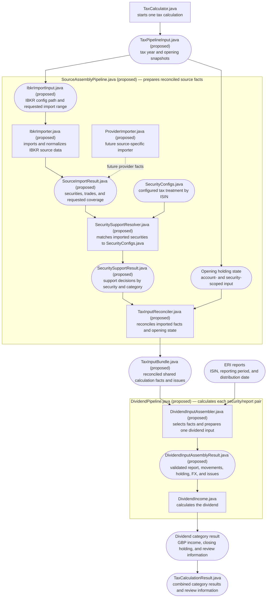
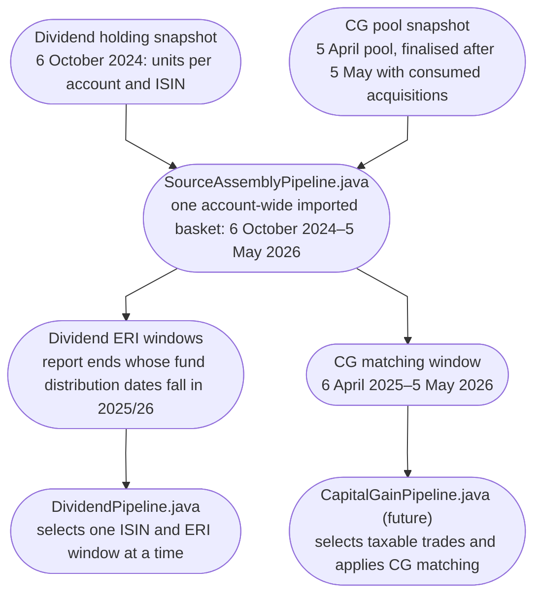

# Design: ACWI dividend run

Planning revision: 7 October 2026. Source: user's request to incorporate the pipeline class redesign discussed on 2 October. The minimal IBKR import boundary was implemented on 7 October at the user's direction. I007 remains incomplete; D001–D006 and D010 retain the unresolved choices below.

## Context

See [proposal.md](proposal.md) for delivery scope and the idea index. The existing design puts security import, configuration lookup, support detection, and dividend assembly under IBKR orchestration. Shared support and dividend preparation should consume provider-independent inputs so another importer can reuse them.

The ACWI run receives account configuration, tax year, optional opening holding state, an ERI report, and FX data. Existing IBKR extraction, configuration, report parsing, FX, domain calculations, and aggregates are reuse candidates. Reuse does not establish that their current input contracts support account reconciliation or that the full run is working.

## Goals and scope boundaries

- Keep IBKR XML access, field interpretation, and normalization in the provider layer.
- Share configuration lookup, category-specific support resolution, input reconciliation, and dividend assembly.
- Deliver the ACWI path through the existing `TaxCalculator` coordinator.
- Preserve provenance, account context, actual input coverage, assumptions, and artifacts.
- Define shared contracts with future category consumers in mind. CG calculation, pool persistence, savings delivery, other provider implementations, and category-selection UI stay in their existing roadmap changes.

## Proposed architecture — I007 / D010

`TaxPipelineInput` is the shared run request. It carries the tax year and the opening holding/CG snapshots; it does not carry IBKR credentials. `SourceAssemblyPipeline` derives the required import range from that tax year and selected categories, then constructs provider-specific input. For the first implementation, `IbkrImportInput` carries an IBKR config path and that requested date range. `IbkrImporter` returns source facts and the requested coverage; it does not decide whether a security is tax-supported or which calculations should run. Retrieval, HTTP, API-status, parsing, and extraction failures propagate rather than being converted to review issues. `TaxInputReconciler` validates the combined account context, duplicate imports, identity conflicts, and coverage before category calculations consume those facts. An incomplete source is a review or incomplete outcome, not proof of empty activity. D003 must settle how an imported source demonstrates holdings without in-window activity.

`DividendPipeline` wraps dividend input assembly and the existing dividend aggregate. It creates a separate calculation for each applicable `(security ISIN, ERI report)` pair. The assembler selects only that security's facts in the report's required window. If one pair lacks required coverage, its review outcome does not prevent another fully covered security/report pair from producing a result. Multiple reports for one security run in distribution-date order, carrying each closing holding into the next calculation's opening holding.

### Shared account import horizon

For a full 2025/26 run, `SourceAssemblyPipeline` may import one account-wide basket from 6 October 2024 through 5 May 2026. The pipeline does not choose instruments before importing: it imports account facts, then category pipelines select the required instruments and windows. The dates are a safe shared horizon, not a substitute for validating each ERI report's stated dates.

The dividend holding snapshot is an account/security quantity baseline: account identity, ISIN, units, timestamp, and source provenance. It lets the system reconstruct units held at a report-period end from later movements; it does not need acquisition cost. A CG pool snapshot is different: it represents the taxpayer's Section 104 state for each relevant security, including quantity and pooled allowable cost. It may also need unresolved matching state for prior disposals whose 30-day window crosses the tax-year boundary; the exact carry-forward contract remains under D007/D010.

For dividends, the system uses ERI reports whose fund distribution date is in the target tax year. The earliest possible report-period end for a 2025/26 fund distribution date is 6 October 2024, six calendar months before the tax-year start. For capital gains, the shared basket extends through 5 May 2026 so a 5 April 2026 disposal can be checked against acquisitions in the following 30 days. A dividend-only run may import a narrower report-derived range; the wider range is the reuse-friendly default when dividend and CG categories run together.

#### ACWI reusable-basket example

The ACWI row below uses State Street's report for the period ended 31 March 2025. The report explicitly states that the fund distribution date is 30 September 2025, so its ERI belongs in 2025/26. Its 1 April 2024 start is inferred from the annual reporting period; source extraction must retain the actual report reference and not assume all funds use this timetable.

| Purpose | Start | End | Extra snapshot or report data |
| --- | --- | --- | --- |
| Shared account facts | 6 October 2024 | 5 May 2026 | — |
| ERI dividends | 6 October 2024 holding boundary | Each eligible fund's reporting-period end | Holding snapshot at the boundary; select each fund by ISIN and ERI report |
| ACWI ERI calculation, 2025/26 | 6 October 2024 | 31 March 2025 | ACWI snapshot at 6 October 2024. Report period: 1 April 2024–31 March 2025; fund distribution date: 30 September 2025 |
| Capital gains | 6 April 2025 | 5 May 2026 | 6 April 2025 Section 104 pool snapshot: quantity, pooled allowable cost, and approved carry-forward matching state |

For example, if the dividend snapshot records 100 ACWI units, the basket records a purchase of 20 units and a sale of 10 units before an illustrative 31 March 2025 report end, the ACWI ERI calculation uses 110 units. The same imported event basket remains available to the later CG change, but that calculation uses its own pool snapshot and date selection.

### Existing pipeline file migration

Names below are proposed contracts. Final signatures depend on task 1.1; no new Java types are created by this planning revision.

| Existing file | Proposed destination | Responsibility change |
| --- | --- | --- |
| `TaxSourcePipeline<I,R>` | `SourceImporter<I>` | Provider-specific import contract: import and normalize source data into `SourceImportResult` without tax-category decisions. |
| `ibkr/IbkrTaxSourcePipeline` | `ibkr/IbkrImporter` | Coordinate IBKR provider calls, parsing, security extraction, and transaction normalization. Remove tax support checks, reconciliation, and dividend assembly. |
| New shared coordinator | `SourceAssemblyPipeline` | Coordinate one or more provider importers, support resolution, and reconciliation; return `TaxInputBundle` for category pipelines. |
| `ibkr/IbkrPipelineInput` | `ibkr/IbkrImportInput` and `TaxPipelineInput` | `IbkrImportInput` keeps the config path and requested date range. `TaxPipelineInput` owns tax year and opening snapshots. |
| `ibkr/IbkrPipelineResult` | `model/SourceImportResult` | Replace `extractedDividends` calculator inputs with imported facts and coverage. Retain securities, provenance, and issues. |
| `ibkr/IbkrSupportedSecurityExtractor` | Split between `IbkrImporter` and `security/SecuritySupportResolver` | Keep fetching/extraction provider-specific; move configuration matching and support decisions into `SourceAssemblyPipeline`. |
| `ibkr/result/IbkrSupportedSecurityExtractionResult` | `security/SecuritySupportResult` | Describe support per category, with reasons and source references. |
| `ibkr/dividend/IbkrDividendExtractor` | `dividend/DividendInputAssembler` | Assemble dividend calculation inputs from shared normalized facts, validated report/opening state, and rates. |
| `ibkr/result/IbkrDividendExtractionResult` | `dividend/DividendInputAssemblyResult` | Carry assembled dividend inputs and preparation issues. |

### Method ownership in the supported-security split

- `importIbkrFlex(...)`, `createApiProvider(...)`, and the call to `IbkrSecurityExtractor.extractSecurities(...)` move into `IbkrImporter`.
- `SourceAssemblyPipeline` loads or receives `SecurityConfigs` and supplies it to shared support resolution.
- `detectSupportedDividendSecurities(...)` and `detectSupportedDividendSecurity(...)` move to the support-resolution step within `SourceAssemblyPipeline`, with category-specific decisions rather than a single supported/unsupported instrument flag.
- `unsupportedInstrumentIssue(...)` moves with support resolution and receives real source/account references instead of hardcoding IBKR.
- Retain all imported securities for review and other consumers. Unsupported dividend configuration must not silently remove facts from the shared input collection.

### Shared contracts and behavior

| Component | Inputs → outputs | Side effects, validation, and errors |
| --- | --- | --- |
| `SourceImporter<I>` / `IbkrImporter` | Provider configuration and an explicit requested date range → `SourceImportResult` | File/network I/O; retain the requested date range. Credentials remain local. Retrieval, API-status, parsing, and extraction failures are fatal in the initial implementation. Do not load security tax configuration or construct category-calculation inputs. |
| `SourceAssemblyPipeline` | Shared run request, one or more importers, loaded configuration, support capabilities, and scoped opening state → `TaxInputBundle` plus preparation issues | Derive each provider import range, coordinate importer output, support resolution, and `TaxInputReconciler`. Category pipelines receive its output rather than raw importer results. |
| `TaxPipelineInput` | Tax year and scoped opening state → shared run request | Data only. The first version contains the tax year and holding/CG snapshots; category selection and account ownership remain under D010. |
| `SourceImportResult` | Imported securities, trades, and requested start/end dates | Data only. The first version does not claim to prove inactive holdings or attach per-trade account provenance; those remain under D003/D010. Review issues begin in support resolution and later preparation, rather than raw import. |
| `SecuritySupportResolver` | Normalized securities/source references, loaded configs, implemented category capabilities → `SecuritySupportResult` | No broker I/O. Distinguish missing configuration from unimplemented methods; configured metadata alone must not advertise executable support. |
| `TaxInputReconciler` | Import results, support decisions, and scoped opening state → `TaxInputBundle` plus preparation issues | In-memory reconciliation. Check identity conflicts, duplicate imports, and coverage before final calculation; preserve account ownership/wrappers. Exact duplicate/transfer/error policies remain under D006/D010. |
| `DividendPipeline` | Shared inputs, support decisions, prepared reports and FX → dividend results, artifacts, and preparation issues | Wrap `DividendInputAssembler` and `DividendIncome`. Coordinate one calculation per applicable security/report pair in distribution-date order. Report/FX loaders own I/O; domain calculators receive explicit objects/rates. Avoid counting report preparation and dividend computation as separate income events. |
| `DividendInputAssembler` | Relevant normalized movements, report, opening holdings, rates, tax year → `DividendInputAssemblyResult` | No broker access. Validate security/report identity, distribution year, opening boundary, movement coverage, and required FX before constructing domain inputs. |
| `TaxCalculator` | Run request → `TaxCalculationResult` | Own shared initialization, invoke `SourceAssemblyPipeline`, and run category pipelines. Merge issue provenance without hiding partial or fatal outcomes. |

`TaxInputBundle` is a typed collection of reconciled inputs, not a single Section 104 pool. Retain `Registry` for shared run resources such as FX documents. Provider/account context must accompany trade IDs so IDs from different sources do not collide and repeated imports can be recognized. Do not blindly sum account-level CG snapshots.

### Reuse and later consumers

Retain `IbkrApiProvider`, `IbkrTradeMapper`, `IbkrSecurityExtractor`, and `IbkrTradeExtractor`; the raw-to-normalized bridge still needs completion. Retain `SecurityConfigs`, `SecurityConfig`, report-format-specific ERI extraction, FX services, and dividend domain models/aggregates, subject to input-contract checks.

The later `CapitalGainPipeline` builds final `TradeBook` instances from relevant combined account transactions before invoking CG calculations. `IbkrTradeBookExtractor` can remain a source-local helper, but does not own that final grouping. The later `SavingsPipeline` consumes normalized cash inputs. These classes are architectural consumers, not additional delivery tasks in this change.

### ACWI execution details retained

1. Run `SourceAssemblyPipeline`: import IBKR source data, retain detected securities, movements, holdings, source coverage, and provenance, then resolve support and reconcile the input bundle.
2. Resolve each configured security's matching ERI report; validate its ISIN and distribution date.
3. For each security/report pair, check that the reconciled coverage and opening state are sufficient for the report period and opening boundary. Any permitted zero fallback must produce an explicit assumption identifying the security and boundary; it must not conceal missing imported activity.
4. Let `DividendPipeline` select the pair's facts, assemble `NonUkDomicileAccumulatingDividend` inputs with report-currency FX, and invoke the existing dividend aggregate. For repeated reports on one security, use the earlier closing holding as the later opening holding.
5. Return GBP income, closing holding artifacts, and calculated/ignored/review/assumption information with source traceability.

The zero-fallback policy is retained from the earlier design. Eligibility and boundary reconciliation remain subject to D005/D006. Existing FX calculation behavior is not newly endorsed as tax policy by this document.

### Alternatives considered

- Keep provider pipelines assembling tax calculators: smallest initial change, but repeats support/report logic for each provider and makes shared preparation harder to enforce.
- Use `SourceAssemblyPipeline` plus category pipelines: recommended I007 direction; preserves implemented extraction and calculation components while making the source-side boundary explicit.
- Rewrite parsers and domain calculators together: broader scope without evidence that wholesale replacement is needed. Review input assumptions and make only required changes during authorized implementation.

## Blocking decisions

These remain explicit gates on dependent implementation, rather than assumptions embedded in task completion criteria.

| ID | Unresolved behavior | Dependent tasks |
| --- | --- | --- |
| D001 | Exact contribution/result ownership, field types, and artifact boundaries | 1.1, 1.8, 1.9, 2.1–2.4 |
| D002 | ERI reporting-year and report path/URI resolution | 1.3, 1.5 |
| D003 | How an imported source establishes held securities with no in-window trades | 1.2, 1.5, 3.1 |
| D004 | Broker FX normalization, rounding, and rate provenance where trade mapping needs GBP | 1.4 |
| D005 | Opening-boundary reconciliation and when an opening-zero assumption is valid | 1.5, 1.6, 3.2 |
| D006 | Partial/fatal outcomes, issue contracts, and incomplete-input handling | 1.1, 1.6–1.10, 3.1–3.3 |
| D010 | Import/result signatures, ownership context, category selection, duplicate/transfer handling, and coverage contracts | 1.1, 1.2, 1.5, 1.8, 2.1–3.3 |

The user's 3 October request authorizes documenting this migration and tasks; it does not settle these remaining choices. D007/D008 continue to govern later CG dispatch and persistence in the separate CG change.

## Migration plan

1. Resolve affected contracts in task 1.1; scaffold shells, then empty signatures only when requested (tasks 2.1–2.4).
2. Build `SourceAssemblyPipeline` around provider import, support resolution, and reconciliation (tasks 1.2, 3.1, and 3.2), retaining existing IBKR extractors.
3. Complete normalized source-assembly outputs and ERI/report validation (tasks 1.3–1.5), then opening selection (1.6).
4. Build shared dividend assembly and orchestration (1.7 and 3.3), then connect the coordinator and result/report boundaries (1.8–1.9).
5. Verify integrated behavior under 1.10; only then complete parent task 1.

Keep old callers compiling until their replacement contracts are wired; retire obsolete wrappers and references with the corresponding migration step. If a migration fails, restore the affected step's changes while preserving unrelated work. No deployment or persistent-data migration is included.

## Risks / trade-offs

- An imported statement can omit inactive holdings → require a scoped holdings/coverage contract under D003.
- Duplicate imports or transfers distort holdings → reconcile provenance and movement meaning before assembly; settle D010 before implementing those rules.
- Similar tickers or differing provider labels merge distinct securities → use validated identity mappings and surface conflicts.
- Missing opening state or movements appears as zero income → expose assumptions and incomplete outcomes separately.
- More shared contracts increase initial wiring work → implement the ACWI slice first and keep other category delivery in its owning changes.
