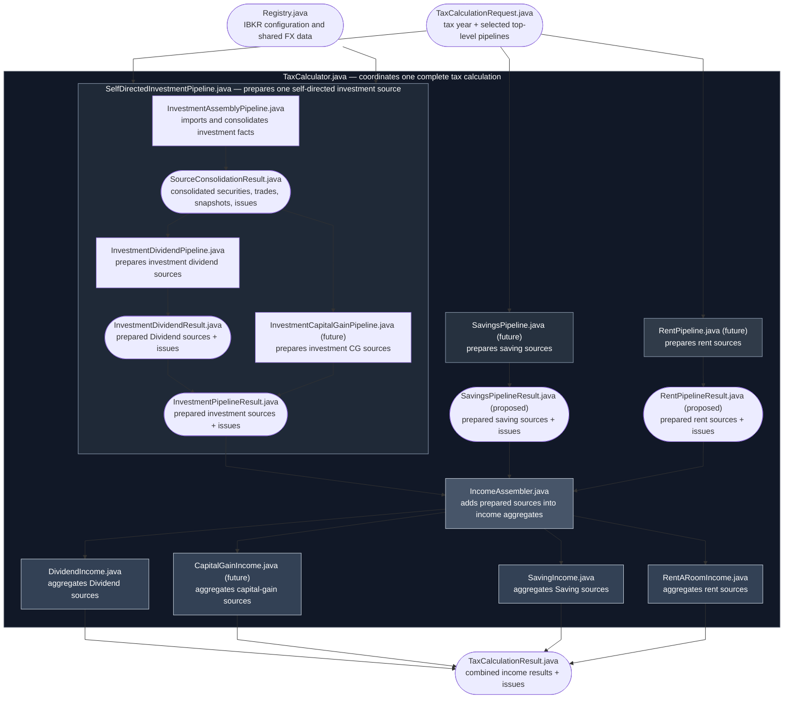
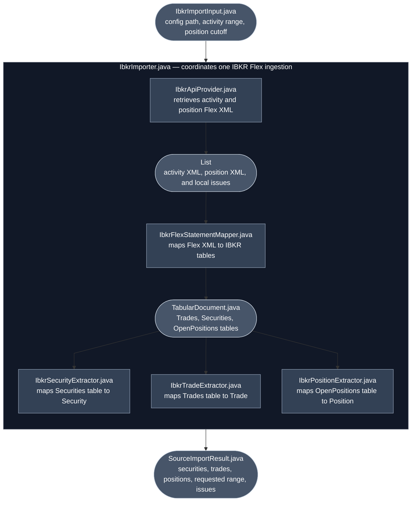
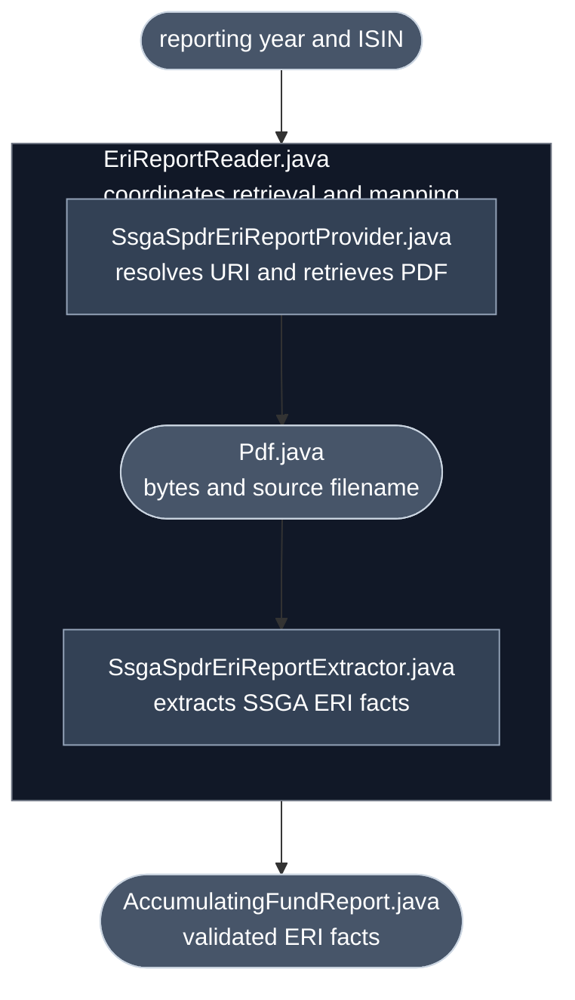
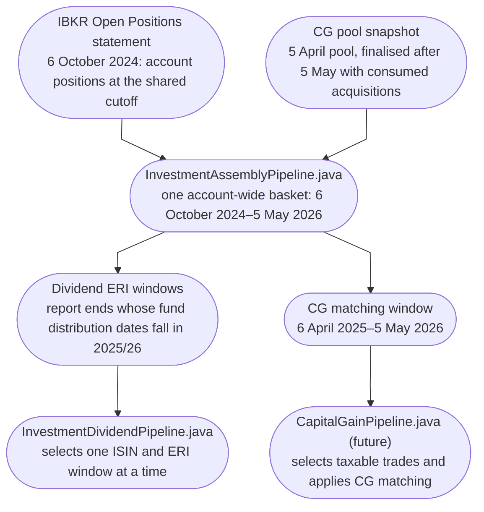

# Design: ACWI dividend run

Planning revision: 6 November 2026. Source: the pipeline redesign and aggregation decisions discussed through 6 November. The minimal IBKR import boundary was implemented on 7 October at the user's direction. I007 remains incomplete; D001–D006 and D010 retain the unresolved choices below.

## Context

See [proposal.md](proposal.md) for delivery scope and the idea index. The existing design puts security import, configuration lookup, support detection, and dividend assembly under IBKR orchestration. Shared support and dividend preparation should consume provider-independent inputs so another importer can reuse them.

The ACWI run receives account configuration, tax year, CG carry-forward state, and FX data. A configured IBKR Flex Positions query supplies raw account positions at the shared cutoff; source consolidation will turn supported rows into security holding snapshots. The importer and source consolidator now create snapshots from returned Positions rows; persistence and coverage policy remain outstanding. The investment pipeline uses `InvestmentDividendPipeline` to fetch and parse the ERI report for each supported security. Existing IBKR extraction, configuration, report parsing, FX, domain calculations, and aggregates are reuse candidates. Reuse does not establish that their current input contracts support account reconciliation or that the full run is working.

## Goals and scope boundaries

- Keep IBKR XML access, field interpretation, and normalization in the provider layer.
- Share configuration lookup, category-specific support resolution, input reconciliation, and dividend assembly.
- Deliver the ACWI path through the existing `TaxCalculator` coordinator and its investment branch.
- Preserve provenance, account context, actual input coverage, assumptions, and artifacts.
- Define shared contracts with future category consumers in mind. CG calculation, pool persistence, savings delivery, other provider implementations, and category-selection UI stay in their existing roadmap changes.

## Proposed architecture — I007 / D010



## IBKR Flex ingestion design

`IbkrImporter.importSource(IbkrImportInput)` is the public call for one complete IBKR Flex ingestion. Its input carries the selected Flex configuration path, requested activity range, and position cutoff. Its output is a provider-neutral `SourceImportResult`: normalized `Security`, `Trade`, and `Position` facts, the imported date range, and recoverable `Issue` records. A caller should not call the mapper or typed extractors itself.



`IbkrFlexStatementMapper` receives Flex **XML**, not a PDF. It uses `XmlDocumentParser` internally to parse each statement and creates the three IBKR-specific tables. It does not call `IbkrSecurityExtractor`, `IbkrTradeExtractor`, or `IbkrPositionExtractor`; `IbkrImporter` calls those after mapping. The mapper is therefore an internal representation change, while the extractors translate individual tables into typed domain facts.

The provider performs the Flex Web Service I/O, date truncation, request splitting, pacing, and API-status mapping. Invalid date ranges, unavailable future-only ranges, non-`1003` Flex failures, invalid XML, and invalid table values fail the import. A `1003` unavailable statement range becomes an `INFO` issue and contributes no XML rows. This keeps API-specific behaviour within the importer boundary while letting later source assembly work only with `SourceImportResult`.

`TaxPipelineInput` is the shared runtime request. It carries the tax year and CG carry-forward state; it does not carry security holding snapshots, provider configuration, or credentials. At the application boundary, a caller selects a top-level pipeline domain such as `INVESTMENT`, not an eventual income category such as `DIVIDENDS`. `SelfDirectedInvestmentPipeline` owns one shared investment assembly pass, prepares today’s dividend sources and later capital-gain sources, and returns one domain result. `IncomeAssembler` then adds that result's sources to their appropriate category aggregates, including `DividendIncome` and future `CapitalGainIncome`. For the initial ACWI delivery, `InvestmentAssemblyPipeline` receives one explicit IBKR configuration path and owns its `IbkrImporter`, fixed `SecurityConfigs`, executable dividend methods, `SecuritySupportResolver`, and `SourceConsolidator`. It derives the shared trade horizon and snapshot boundary directly from the tax year: 6 October before the tax year through 5 May after it, with the first requested date, 6 October, also used for the Positions query. An IBKR import always requests both Activity and Positions statements, so callers cannot supply a different cutoff. `IbkrImporter` retrieves the account-wide Open Positions statement as part of its normal import work, retains it as source evidence, and returns normalized provider-neutral `Position` facts in `SourceImportResult` alongside securities and trades. It needs no separate opening-position importer or pipeline. It exposes `getActivityStatementsXml(fromDate, toDate)` and `getPositionStatementXml(positionDate)` so the importer can request trades and the one-day cutoff without receiving either configured query ID. The provider remains generic: it retrieves XML, applies date limits and pacing, and maps Flex API failures; it does not know `OpenPosition` fields or create domain facts. `IbkrFlexStatementMapper` combines Activity and Positions XML into one IBKR-only `TabularDocument` with `Trades`, `Securities`, and `OpenPositions` tables. `IbkrSecurityExtractor`, `IbkrTradeExtractor`, and `IbkrPositionExtractor` each read their table and return normalized facts; only `Position` leaves the importer for position data. It carries a raw position's source, account, ISIN, quantity, cutoff date, and statement provenance. `SourceConsolidator` filters those facts to supported ISINs, groups them by ISIN, and creates one broker-neutral `SecurityHoldingSnapshot` baseline from the selected positions. It combines quantities from distinct selected source accounts at the same cutoff. If no supported position row is returned, including after a recoverable Positions `1003`, it creates a zero snapshot and retains the relevant `INFO` issue. It must reject duplicate imports, conflicting identities, or mismatched cutoffs rather than silently double count. This replaces manually supplied IBKR snapshots. `IbkrApiProvider` partitions the longer trade horizon into adjacent requests of at most 365 days and returns their raw statements in chronological order. Before issuing requests, it truncates a requested end date to the previous New York weekday because Activity Flex Query data is available only through the previous business day. A wholly future range fails locally; a past `1003` yields no XML and therefore zero `Position` rows for that request, plus an `INFO` issue. The weekday rule does not model IBKR holidays. A direct Flex request successfully retrieved a 1 December 2025–31 May 2026 report on 14 October 2026, verifying the configured query and explicit-date override. Earlier 1003 responses for older chunks establish only that those statement requests were unavailable; they do not establish a transport range limit. `IbkrImporter` does not decide whether a security is tax-supported or which calculations should run. The recoverable `1003` Flex API status becomes a local issue; other Flex API-status failures, retrieval, HTTP, parsing, and extraction failures propagate as exceptions. `SecuritySupportResolver` produces support decisions and review issues from the aggregated import. `PreparedSource` is a tuple-like internal input that pairs unchanged provider facts with its support decision. `SourceConsolidator` returns `SourceConsolidationResult`; it does not return prepared sources downstream. Each `ConsolidatedSecurityFacts` contains its security, configured tax treatment, all matching source trades, one consolidated holding snapshot, and one optional CG carry-forward snapshot. `SourceConsolidationResult` also contains the consolidated review issues. Unsupported securities stay outside the calculation input. Coverage and account policies remain under D005/D006/D010. An incomplete source is a review or incomplete outcome, not proof of empty activity. When a second provider is actually onboarded, user-selected source requests will produce the same normalized facts; support and consolidation stages remain unchanged.

Today, source consolidation has no security-metadata merge. It keys `ConsolidatedSecurityFacts` by ISIN, adds matching trades from later sources, and retains the first `Security` object's ticker, name, and currency without comparison. That implementation detail is temporary: the position change adds quantity consolidation, while metadata conflict and canonical-security policy remain D010 work.

`SelfDirectedInvestmentPipeline` is the initial top-level implementation for self-directed investment work. It owns one `InvestmentAssemblyPipeline` pass, then asks its internal `InvestmentDividendPipeline` and future `InvestmentCapitalGainPipeline` to prepare their category-specific sources from the shared consolidated facts. This avoids importing and consolidating investment data once for dividends and again for capital gains. A later `ManagedInvestmentPipeline` is a sibling for provider annual tax packs, such as J.P. Morgan Personal Investing. It does not reuse raw-trade source assembly, security support resolution, ERI loading, holding snapshots, or local CG matching when a provider supplies final reported tax figures. Both paths ultimately provide investment-category contributions to `IncomeAssembler`; their future shared source-selection/coordinator contract is deferred until managed-investment onboarding. `InvestmentDividendPipeline` groups `ConsolidatedSecurityFacts` entries by configured dividend method, then uses `DividendMethodDispatcher` to send each group to the matching method-specific pipeline. `DividendMethodPipeline` is the strategy contract; each implementation declares its one `DividendCalculationMethodType` and returns a `DividendMethodResult` for its assigned securities. The dispatcher directly declares the currently supported methods in an immutable map. Its lookup returns an empty result when the configured type has no implementation. The outer investment dividend pipeline turns that absence into `UNIMPLEMENTED_DIVIDEND_METHOD` review issues; the dispatcher does not create issues, fetch reports, or calculate income. `NonUkAccumulatingFundDividendPipeline` is the ACWI path: it uses `EriReportReaderDispatcher` to select the reader for its configured ERI report format and asks it for the relevant ISIN and reporting year, which is the tax-year start year. For a 2025/26 run, this selects the report for the period ending in 2025, whose distribution date must lie in 2025/26. It supplies the 6 October baseline snapshot and only later trades through the report end to `NonUkDomicileAccumulatingDividend`. That domain class derives the report-end holding as part of its calculation, applies the available monthly and/or yearly report-currency FX rates from the run registry, validates the source calculation, and returns it for later aggregation. An unsupported ERI format, ERI load or parse failure, absent or incorrect-boundary snapshot, unavailable FX rate, or invalid prepared dividend produces an `ERROR` issue for that ISIN and skips only that source. Other investment dividend methods prepare their own results and do not load ERI reports. `InvestmentDividendPipeline` merges the method-pipeline results into one `InvestmentDividendResult`, containing all prepared `Dividend` sources and the investment-dividend review issues.

### ERI report retrieval and mapping

ERI report retrieval and report interpretation are separate replaceable concerns. `EriReportProvider` receives a reporting year and returns a shared `Pdf`. For SSGA, `SsgaSpdrEriReportProvider` owns URI construction, supported-year validation, and HTTP retrieval. `EriReportExtractor` receives that `Pdf`, ISIN, and reporting year and returns `AccumulatingFundReport`. The initial `SsgaSpdrEriReportExtractor` uses `PdfTextExtractor` and parses the SSGA table; a later AI-backed extractor may consume the same `Pdf` differently. `EriReportReader` is the caller-facing coordinator because it reads one fund's report facts through a provider and extractor. `EriReportReaderDispatcher` routes each `EriReportFormat` to one fully configured reader, rather than dispatching providers and extractors separately. Changing parsing logic therefore does not change retrieval, URL rules, or HTTP handling.



`IncomeAssembler` is the proposed bridge between domain pipelines and the established income aggregates. It receives an `InvestmentPipelineResult`, `SavingsPipelineResult`, or `RentPipelineResult`; it adds each prepared source to the appropriate run-owned aggregate such as `DividendIncome`, `SavingIncome`, `RentARoomIncome`, or future `CapitalGainIncome`; then those aggregates create their respective `IncomeResult`s. It also combines the pipeline-result issues once. Domain pipelines must not mutate income aggregates directly, and `TaxCalculator` must not know individual source types such as `Dividend`. `TaxCalculationResult` receives the finished income results and the combined issues. `IncomeAssembler` does not decide tax treatment, perform source calculations, or retrieve data. It is the single location that converts prepared pipeline sources into the existing aggregate classes. The exact result contract for a pipeline with multiple prepared categories, selection by pipeline domain rather than `IncomeType`, and final reporting subdivisions remain D010 decisions.

`IbkrApiProvider` waits 1.1 seconds between adjacent `SendRequest` calls, satisfying IBKR's one-request-per-second pacing rule for the initial two-year import scope. It does not yet enforce IBKR's broader ten-requests-per-minute limit, so a token already rate-limited by other calls can still return `1018`. The provider maps a private `IbkrFlexApiException` at its date-range boundary into a local issue only when the error is recoverable. Error `1003` produces `IBKR_STATEMENT_UNAVAILABLE` at severity `INFO`, then the provider continues with adjacent ranges. Rate-limit error `1018` and every other Flex API failure propagate as exceptions because the import cannot safely continue. The `1003` issue records its failed start date, end date, provider code, and provider message. Network, HTTP, and XML parsing failures also propagate as exceptions because no valid Flex failure response exists to map. `IbkrImporter` places local issues in `SourceImportResult`; `SourceConsolidator` merges them with support issues into `SourceConsolidationResult`. No global registry or issue plumbing through unrelated stages is required.

### Pipeline package layout

The `pipeline` root contains only contracts shared by all tax pipelines. Investment-specific code lives under `investment`, grouped by the stage that owns it. Provider-specific classes live below their provider's importer package; no other stage should depend on an IBKR type.

```text
pipeline/
├── TaxPipeline.java
├── TaxPipelineFactory.java
├── TaxPipelineResult.java
├── IncomeAssembler.java
└── investment/
    ├── SelfDirectedInvestmentPipeline.java
    ├── InvestmentPipelineResult.java
    ├── TaxPipelineInput.java
    ├── assembly/
    │   └── InvestmentAssemblyPipeline.java
    ├── importer/
    │   ├── SourceImporter.java
    │   ├── SourceImportResult.java
    │   └── ibkr/
    │       ├── IbkrImportInput.java
    │       └── IbkrImporter.java
    ├── support/
    │   ├── SecuritySupportResolver.java
    │   └── SecuritySupportResult.java
    ├── consolidation/
    │   ├── PreparedSource.java
    │   ├── SourceConsolidator.java
    │   ├── SourceConsolidationResult.java
    │   └── ConsolidatedSecurityFacts.java
    └── dividend/
        ├── DividendMethodDispatcher.java
        ├── DividendMethodPipeline.java
        ├── InvestmentDividendPipeline.java
        ├── InvestmentDividendResult.java
        ├── DividendMethodResult.java
        └── future dividend-stage classes
```

### Shared account trade horizon and cutoff snapshot

For a full 2025/26 run, `InvestmentAssemblyPipeline` plans one account-wide basket from 6 October 2024 through 5 May 2026. `IbkrApiProvider` first caps its effective end date at the previous New York weekday, then transparently uses contiguous Flex requests of at most 365 days. The pipeline does not choose instruments before importing: it imports account facts, then category pipelines select the required instruments and windows. The dates are a safe shared horizon, not a substitute for validating each ERI report's stated dates.



The IBKR Open Positions statement is an account-wide source artifact at the shared cutoff. It contains account identity, ISIN, units, timestamp, and source provenance for every reported position. `IbkrImporter` maps these into `Position` facts; `SourceConsolidator` selects supported ISIN rows and creates each broker-neutral `SecurityHoldingSnapshot` baseline. It does not need acquisition cost. The accepted statement, raw source positions, and selected snapshot are persisted as tax-run artifacts so a completed calculation remains reproducible even when IBKR no longer makes the historical statement available. A CG pool snapshot is different: it represents the taxpayer's Section 104 state for each relevant security, including quantity and pooled allowable cost. It may also need unresolved matching state for prior disposals whose 30-day window crosses the tax-year boundary; the exact carry-forward contract remains under D007/D010.

For dividends, the system uses ERI reports whose fund distribution date is in the target tax year. The earliest possible report-period end for a 2025/26 fund distribution date is 6 October 2024, six calendar months before the tax-year start. The baseline snapshot at that date plus later security trades lets the dividend domain calculation derive holdings at each actual report end. For capital gains, the shared basket extends through 5 May 2026 so a 5 April 2026 disposal can be checked against acquisitions in the following 30 days. A dividend-only run may import a narrower report-derived range; the wider range is the reuse-friendly default when dividend and CG categories run together.

#### ACWI reusable-basket example

The ACWI row below uses State Street's report for the period ended 31 March 2025. The report explicitly states that the fund distribution date is 30 September 2025, so its ERI belongs in 2025/26. Its 1 April 2024 start is inferred from the annual reporting period; source extraction must retain the actual report reference and not assume all funds use this timetable.

| Purpose | Start | End | Extra snapshot or report data |
| --- | --- | --- | --- |
| Shared account facts | 6 October 2024 | 5 May 2026 | — |
| ERI dividends | 6 October 2024 holding boundary | Each eligible fund's reporting-period end | One account-wide Open Positions statement at the boundary; select each fund by ISIN and apply later trades |
| ACWI ERI calculation, 2025/26 | 6 October 2024 | 31 March 2025 | ACWI baseline snapshot at 6 October 2024; derive 31 March 2025 holding from later ACWI trades. Report period: 1 April 2024–31 March 2025; fund distribution date: 30 September 2025 |
| Capital gains | 6 April 2025 | 5 May 2026 | 6 April 2025 Section 104 pool snapshot: quantity, pooled allowable cost, and approved carry-forward matching state |

For example, if the baseline snapshot records 100 ACWI units, the basket records a purchase of 20 units and a sale of 10 units before the 31 March 2025 report end, `NonUkDomicileAccumulatingDividend` derives 110 units for the ERI calculation. The same imported event basket remains available to the later CG change, but that calculation uses its own pool snapshot and date selection.

### Existing pipeline file migration

Names below are proposed contracts. Final signatures depend on task 1.1; no new Java types are created by this planning revision.

| Existing file | Proposed destination | Responsibility change |
| --- | --- | --- |
| `TaxSourcePipeline<I,R>` | `SourceImporter<I>` | Provider-specific import contract: import and normalize source data into `SourceImportResult` without tax-category decisions. |
| `ibkr/IbkrTaxSourcePipeline` | `ibkr/IbkrImporter` | Coordinate IBKR provider calls, parsing, security extraction, and transaction normalization. Remove tax support checks, reconciliation, and dividend assembly. |
| New shared coordinator | `assembly/InvestmentAssemblyPipeline` | Derive the shared IBKR horizon, import one configured source, resolve support, and consolidate results for category pipelines. |
| `ibkr/IbkrPipelineInput` | `importer/ibkr/IbkrImportInput` and `TaxPipelineInput` | `InvestmentAssemblyPipeline` creates one `IbkrImportInput` from its optional stored config path and tax-year-derived horizon. `TaxPipelineInput` owns the tax year and CG carry-forward state; the consolidator derives opening holding snapshots from imported positions. `IbkrApiProvider` hides its request-size limit. |
| `ibkr/IbkrPipelineResult` | `SourceImportResult` | Replace `extractedDividends` calculator inputs with imported securities, trades, `requestedStartDate`, and `requestedEndDate`. The dates record the request; they do not prove coverage. |
| `ibkr/IbkrSupportedSecurityExtractor` | Split between `IbkrImporter` and `security/SecuritySupportResolver` | Keep fetching/extraction provider-specific; move configuration matching and support decisions into `InvestmentAssemblyPipeline`. |
| `ibkr/result/IbkrSupportedSecurityExtractionResult` | `security/SecuritySupportResult` | Describe support per category, with reasons and source references. |
| `ibkr/dividend/IbkrDividendExtractor` | `dividend/method/NonUkAccumulatingFundDividendPipeline` | Prepare accumulating-fund dividend inputs from shared normalized facts, validated report/opening state, and rates. |
| `ibkr/result/IbkrDividendExtractionResult` | `dividend/InvestmentDividendResult` | Carry prepared dividend sources and review issues. |

### Method ownership in the supported-security split

- `importIbkrFlex(...)`, `createApiProvider(...)`, and the call to `IbkrSecurityExtractor.extractSecurities(...)` move into `IbkrImporter`.
- `InvestmentAssemblyPipeline` receives `SecurityConfigs` once for the run and supplies it to shared support resolution.
- `detectSupportedDividendSecurities(...)` and `detectSupportedDividendSecurity(...)` move to the support-resolution step within `InvestmentAssemblyPipeline`, with category-specific decisions rather than a single supported/unsupported instrument flag.
- `unsupportedInstrumentIssue(...)` moves with support resolution and receives real source/account references instead of hardcoding IBKR.
- Retain all imported securities for review and other consumers. Unsupported dividend configuration must not silently remove facts from the shared input collection.

### Shared contracts and behavior

| Component | Inputs → outputs | Side effects, validation, and errors |
| --- | --- | --- |
| `SourceImporter<I>` / `IbkrImporter` | Provider configuration and an explicit requested date range → `SourceImportResult` | File/network I/O; `IbkrApiProvider` caps the effective end at the previous New York weekday and the result records that effective range. Credentials remain local. Retrieval, API-status, parsing, and extraction failures are fatal in the initial implementation. Do not load security tax configuration or construct category-calculation inputs. |
| `InvestmentAssemblyPipeline` | Explicit IBKR configuration path and `TaxPipelineInput` → `SourceConsolidationResult` | Its public convenience constructor receives the selected IBKR path and supplies the fixed security configuration, importer, supported dividend methods, support resolver, and consolidator. It declares `IOException`, so unreadable security configuration prevents the application pipeline from starting. It derives the initial combined dividend/CG horizon directly, then coordinates them. The provider hides Flex request partitioning and returns a local issue for unavailable `1003` statement ranges. Tax pipelines receive its output rather than raw importer results. Other provider retrieval failures propagate. A provider router is deferred until a second provider is onboarded. |
| `TaxPipelineInput` | Tax year and CG carry-forward state → shared runtime request | Data only. It never carries opening holding snapshots. The first IBKR version obtains source positions through the configured Flex Positions query at the shared earliest dividend boundary; category selection and account ownership remain under D010. |
| `SourceImportResult` | Imported securities, trades, source positions, local provider issues, and requested dates | Data only. `Position` contains the normalized account, security identity, quantity, cutoff date, and statement provenance for one Open Positions row. The result does not claim complete source coverage or attach per-trade account provenance; those remain under D010. It retains a provider's non-fatal unavailable-range issues; support resolution and later preparation add their own review issues. |
| `SecuritySupportResolver` | Securities from one `SourceImportResult`, loaded configs, and the set of executable dividend methods → one `SecuritySupportResult` | No broker I/O. The result contains supported securities/configuration and distinct review issues for missing configuration, an explicitly unsupported method, or a configured method absent from the executable set. `InvestmentAssemblyPipeline` keeps the associated import facts for reconciliation. Configured metadata alone must not advertise executable support. |
| `PreparedSource` | One `SourceImportResult` plus its `SecuritySupportResult` → paired consolidator input | Data only. Preserves the relationship between provider facts and support decisions while consolidation runs; it is not returned to category pipelines. |
| `SourceConsolidator` | `List<PreparedSource>` and `TaxPipelineInput` → `SourceConsolidationResult` | In-memory consolidation. For each supported ISIN, combine matching imported trades and validated `Position` quantities with its config into one `ConsolidatedSecurityFacts`, creating one consolidated holding snapshot at the shared cutoff. Combine issues from every `SecuritySupportResult`, retaining one of each logical issue identified by code, source, and attributes. Do not include unsupported securities. Reject duplicate imports, conflicting identities, and mismatched cutoffs before combining positions. Transfer, coverage, and account policies remain under D005/D006/D010. |
| `SourceConsolidationResult` | Tax year, `List<ConsolidatedSecurityFacts>`, and `List<Issue>` → category-pipeline input | Data only. It is the consolidated result for the tax run and keeps non-fatal source-assembly review issues for later result aggregation. `Issue` is the application-wide non-fatal condition type: its code, severity, source, and attributes identify the issue without tying it to a tax category or pipeline stage. |
| `ConsolidatedSecurityFacts` | Security, config, trades, optional holding snapshot, and optional CG carry-forward snapshot for one ISIN → per-instrument category input | Data only. All facts are scoped to this instrument; a category pipeline selects only the fields it needs. |
| `InvestmentDividendPipeline` | `SourceConsolidationResult` and TaxCalculator's prefetched FX registry → `InvestmentDividendResult` | Construct its `DividendMethodDispatcher` internally. Read the tax year from consolidated source facts, group securities by method, pass the tax year and shared registry to each method, merge their results, and return one combined investment dividend result; it does not own or mutate the tax-year aggregate. |
| `DividendMethodDispatcher` | One configured method type → matching application-supported strategy, when registered | In-memory routing only. It directly registers the application's currently supported investment dividend pipelines in an immutable `Map.of(...)` and returns an empty lookup for an absent strategy. It does not create issues or invoke preparation. |
| `DividendMethodPipeline` | One configured method type, tax year, prefetched FX registry, and `List<ConsolidatedSecurityFacts>` → `DividendMethodResult` | Interface contract. Each implementation declares exactly one method type and prepares all securities assigned to it. |
| `NonUkAccumulatingFundDividendPipeline` | Accumulating-fund security/configuration and shared facts → `DividendMethodResult` | Scaffolded method pipeline for the `NON_UK_ACCUMULATING_FUND` path. It currently declares its dispatcher method type only; its future implementation will select the reader for the configured ERI report format, validate each selected security/report pair, and prepare dividend sources plus review issues. |
| `EriReportReader` | `EriReportProvider` and `EriReportExtractor`; ISIN and reporting year → `AccumulatingFundReport` | Coordinator only. It retrieves a PDF through its provider, then reads the named ISIN through its extractor. |
| `EriReportProvider` | Reporting year → `Pdf` | Retrieval contract. A provider owns issuer URL rules, supported-year validation, transport, and source naming. |
| `EriReportExtractor` | `Pdf`, ISIN, and reporting year → `AccumulatingFundReport` | Interpretation contract. An extractor owns a report format's parsing and validation without knowing how the PDF was obtained. |
| `EriReportReaderDispatcher` | `EriReportFormat` → matching configured `EriReportReader`, when registered | In-memory routing only. It directly registers the application's supported provider/extractor combinations and does not retrieve or parse reports itself. |
| `SsgaSpdrEriReportProvider` | Reporting year → SSGA Europe I `Pdf` | Supports verified reporting years 2023–2025 only. It generates the normal 2024–2025 SSGA Europe I URI from the reporting year and retains the distinct 2023 reissued-report filename. Other years fail locally before retrieval. |
| `SsgaSpdrEriReportExtractor` | SSGA Europe I `Pdf`, ISIN, and reporting year → `AccumulatingFundReport` | Uses `PdfTextExtractor` and extracts the selected ISIN from the shared issuer report. Its deterministic parsing can later be replaced without changing SSGA retrieval. |
| `InvestmentDividendResult` | `List<Dividend>` and `List<Issue>` → one investment-dividend output | Data only. It carries all prepared dividend sources and non-fatal investment-dividend preparation issues for one tax calculation. |
| `DividendMethodResult` | `List<Dividend>` and `List<Issue>` → one method-pipeline output | Data only. It carries dividend sources and non-fatal issues produced by one method-specific pipeline. |
| `Registry` | Caller-supplied typed run context → shared configuration and artifacts | The caller provides source selection such as `IBKR_CONFIG_PATH`; `TaxCalculator` adds tax-year FX documents before it creates category pipelines. A future UI will provide an authorized source-configuration reference rather than a filesystem path. |
| `TaxCalculationRequest` | Tax year and selected `IncomeType` values → one requested calculation run | Data only. It is the programmatic boundary used by both a future CLI and UI. It does not carry configuration paths or credentials. Replacing the temporary category selection with top-level pipeline selection remains D010 work. |
| `TaxPipelineFactory` | Shared run `Registry` → one top-level `TaxPipeline` | Application registration contract. It creates a run-specific investment, savings, or rent pipeline only after shared reference data is available. |
| `TaxPipeline` | `TaxCalculationRequest` → one domain-specific `TaxPipelineResult` | Domain contract. It is already bound to the shared run registry and returns prepared sources plus its non-fatal issues. It does not create an `IncomeResult` or mutate an income aggregate. |
| `SelfDirectedInvestmentPipeline` | `TaxPipelineInput`, shared registry → `InvestmentPipelineResult` | Runs `InvestmentAssemblyPipeline` once, then prepares all relevant self-directed investment category sources from the shared consolidation output. The initial delivery produces dividend sources through `InvestmentDividendPipeline`; capital-gain preparation is a later internal branch. |
| `IncomeAssembler` | Concrete `TaxPipelineResult` objects → `Map<IncomeType, IncomeResult>` and combined `List<Issue>` | In-memory aggregation. Its static map routes each registered result class to one handler. A handler adds prepared sources to the matching run-owned aggregate, then `build()` asks each aggregate for its result. It merges issues once. It never imports, calculates a source, decides support, or retrieves data. |
| `TaxCalculationResult` | Tax year, completed income results, and combined issues → combined run result | Data only. It contains at most one completed result for each income type and carries source, preparation, and aggregation issues without making the UI inspect individual pipelines. A future tax-liability summary remains separate. |
| `TaxCalculator` | `TaxCalculationRequest` and caller `Registry` → `TaxCalculationResult` | Adds shared tax-year data to the supplied registry, creates only the selected top-level pipelines, passes their results to `IncomeAssembler`, and returns its completed results and combined issues. The initial delivery selects only investment work and produces dividends. |

`SourceConsolidationResult` is a typed collection of per-instrument facts, not a single Section 104 pool. `ConsolidatedSecurityFacts` groups matching facts by ISIN but does not deduplicate provider records or blindly sum account-level CG snapshots. Retain `Registry` for shared run resources such as FX documents. Provider/account context must accompany trade IDs before duplicate-import and transfer policies can be implemented.

### Tax-calculation request, top-level pipelines, and aggregation — D010 partial decision

`TaxCalculator` is the application-facing facade, rather than a CLI-specific API. A local CLI can call `run(request)`, which builds a registry containing the default local IBKR path and tax-year FX documents. A UI creates a typed `Registry` containing its authorized source configuration and calls `run(request, registry)`. Both list available top-level pipelines, let the user select a subset, and create one `TaxCalculationRequest`; neither accesses internal pipeline registrations or performs tax preparation itself. Registry initialization adds missing FX documents but preserves a caller-provided one.

`TaxCalculator` currently owns a static mapping from `IncomeType` to `TaxPipelineFactory`. This is a temporary selection boundary: it registers the investment pipeline under `DIVIDENDS` until a later change introduces selectable investment, savings, and rent pipeline domains. A request selection is separate from registration. A request that selects an unregistered category fails validation before any source or network work begins. After registry initialization, the calculator creates only the selected pipelines.

Security tax treatment remains application-owned reference data, loaded from the fixed default security configuration. IBKR Flex configuration identifies a user's broker account, so the caller puts the selected local path under `RegistryKeys.IBKR_CONFIG_PATH`; a future UI will instead put an authorized source-configuration reference in the registry. `TaxCalculationRequest` remains free of configuration paths and credentials.

### IBKR source-configuration normalization

The current IBKR path is not yet aligned with the document-source boundary: `RegistryKeys.IBKR_CONFIG_PATH`, `InvestmentAssemblyPipeline`, and `IbkrImportInput` still carry a local `Path`. Task 1.8.2 replaces that path boundary.

The normalized IBKR value is not document bytes. It is one typed `IbkrFlexConfiguration` containing the Flex token, Activity query ID, Positions query ID, and API version for one authorized account. The CLI reads its local properties file and creates this value. A future GUI backend obtains the same values from its authorized connection or secret store. Both put `IbkrFlexConfiguration` into the run `Registry`; no path reaches `TaxCalculator`, `SelfDirectedInvestmentPipeline`, `InvestmentAssemblyPipeline`, or `IbkrImporter`.

`IbkrImportInput` then carries only the requested Activity dates and Positions cutoff. `IbkrApiProvider` receives the already-resolved `IbkrFlexConfiguration` and performs the Flex requests. This is the API-source equivalent of the managed-document rule: different product adapters resolve their own input source, then downstream calculation code receives one normalized typed value without knowing whether it came from a local file, a GUI-managed connection, or another authorized connector.

Once `TaxCalculator` has initialized the registry, its investment factory creates `SelfDirectedInvestmentPipeline` from the complete registry. That pipeline constructs its internal `InvestmentAssemblyPipeline` from `IBKR_CONFIG_PATH` and uses `InvestmentDividendPipeline` for dividend-source preparation. It returns `InvestmentPipelineResult`, containing prepared investment sources and source-assembly/preparation issues. `TaxCalculator` loops over selected pipelines and gives each whole result to `IncomeAssembler`. The assembler's static result-class map sends `InvestmentPipelineResult` to its investment handler, which adds prepared dividend sources to `DividendIncome`; `build()` obtains the aggregate's `IncomeResult` and carries issues once. The same investment assembly route will later prepare capital-gain sources without a second import; the handler will add those to `CapitalGainIncome`. `TaxCalculationResult` therefore receives completed income results, regardless of which pipeline created their sources.

### Reuse and later consumers

Retain `IbkrApiProvider`, `IbkrFlexStatementMapper`, `IbkrSecurityExtractor`, `IbkrTradeExtractor`, and `IbkrPositionExtractor`. The trade extractor reads raw IBKR trade fields directly: `isin`, `transactionID`, `tradeDate`, `buySell`, `quantity`, `proceeds`, and `ibCommission`. It skips non-security rows without an ISIN and currently accepts only GBP rows; D004 still defines future FX normalization, rounding, and provenance for other currencies. Retain `SecurityConfigs`, `SecurityConfig`, report-format-specific ERI extraction, FX services, and dividend domain models/aggregates, subject to input-contract checks.

The later `CapitalGainPipeline` builds final `TradeBook` instances from relevant combined account transactions before invoking CG calculations. `IbkrTradeBookExtractor` can remain a source-local helper, but does not own that final grouping. The later `SavingsPipeline` consumes normalized cash inputs. These classes are architectural consumers, not additional delivery tasks in this change.

### ACWI execution details retained

1. Run `InvestmentAssemblyPipeline`: derive the shared import horizon from `TaxPipelineInput`, ask its configured `IbkrImporter` to import it, retain detected securities, movements, `requestedStartDate`, and `requestedEndDate`, then resolve support and consolidate the inputs. `IbkrApiProvider` partitions a horizon longer than 365 days into adjacent Flex requests before the importer aggregates their normalized facts.
2. `DividendMethodDispatcher` routes each configured security to its method pipeline. For ACWI, `NonUkAccumulatingFundDividendPipeline` selects the SSGA extractor from its configured ERI report format; the extractor resolves and fetches the matching report, then validates its ISIN and distribution date.
3. For each security/report pair, check that the reconciled coverage and opening state are sufficient for the report period and opening boundary. Any permitted zero fallback must produce an explicit assumption identifying the security and boundary; it must not conceal missing imported activity.
4. Let `InvestmentDividendPipeline` select the pair's facts, assemble `NonUkDomicileAccumulatingDividend` inputs with report-currency FX, and invoke the existing dividend aggregate. For repeated reports on one security, use the earlier closing holding as the later opening holding.
5. Return GBP income, closing holding artifacts, and calculated/ignored/review/assumption information with source traceability.

The zero-fallback policy is retained from the earlier design. Eligibility and boundary reconciliation remain subject to D005/D006. Existing FX calculation behavior is not newly endorsed as tax policy by this document.

### Alternatives considered

- Keep provider pipelines assembling tax calculators: smallest initial change, but repeats support/report logic for each provider and makes shared preparation harder to enforce.
- Use `InvestmentAssemblyPipeline` plus category pipelines: recommended I007 direction; preserves implemented extraction and calculation components while making the source-side boundary explicit.
- Rewrite parsers and domain calculators together: broader scope without evidence that wholesale replacement is needed. Review input assumptions and make only required changes during authorized implementation.

## Blocking decisions

These remain explicit gates on dependent implementation, rather than assumptions embedded in task completion criteria.

| ID | Unresolved behavior | Dependent tasks |
| --- | --- | --- |
| D001 | Exact contribution/result ownership, field types, and artifact boundaries | 1.1, 1.8, 1.9, 2.1–2.4 |
| D002 | ERI reporting-year and report path/URI resolution | 1.3, 1.5 |
| D003 | Decided for IBKR: obtain one account-wide Open Positions statement at the shared earliest dividend boundary, return normalized source positions, and consolidate supported ISIN rows into the opening snapshot; retain an unavailable statement as a reviewable issue while using a zero holding snapshot | 1.5, 1.6, 3.1 |
| D004 | Broker FX normalization, rounding, and rate provenance where trade mapping needs GBP | 1.4 |
| D005 | Opening-boundary reconciliation and when an opening-zero assumption is valid | 1.5, 1.6, 3.2 |
| D006 | Partial/fatal outcomes, issue contracts, and incomplete-input handling | 1.1, 1.6–1.10, 3.1–3.3 |
| D010 | Import/result signatures, ownership context, category selection, duplicate/transfer handling, and coverage contracts | 1.1, 1.2, 1.5, 1.8, 2.1–3.3 |

The user's 3 October request authorizes documenting this migration and tasks; it does not settle these remaining choices. D007/D008 continue to govern later CG dispatch and persistence in the separate CG change.

## Migration plan

1. Resolve affected contracts in task 1.1; scaffold shells, then empty signatures only when requested (tasks 2.1–2.4).
2. Build `InvestmentAssemblyPipeline` around provider import, support resolution, and reconciliation (tasks 1.2, 3.1, and 3.2), retaining existing IBKR extractors.
3. Complete normalized source-assembly outputs and ERI/report validation (tasks 1.3–1.5), then opening selection (1.6).
4. Build method-specific dividend preparation and orchestration (1.7 and 3.3), then connect the coordinator and result/report boundaries (1.8–1.9). Extract shared preparation only when future methods demonstrate repeated logic.
5. Verify integrated behavior under 1.10; only then complete parent task 1.

Keep old callers compiling until their replacement contracts are wired; retire obsolete wrappers and references with the corresponding migration step. If a migration fails, restore the affected step's changes while preserving unrelated work. No deployment or persistent-data migration is included.

## Risks / trade-offs

- An imported statement can omit inactive holdings → require a scoped holdings/coverage contract under D003.
- Duplicate imports or transfers distort holdings → reconcile provenance and movement meaning before assembly; settle D010 before implementing those rules.
- Similar tickers or differing provider labels merge distinct securities → use validated identity mappings and surface conflicts.
- Missing opening state or movements appears as zero income → expose assumptions and incomplete outcomes separately.
- More shared contracts increase initial wiring work → implement the ACWI slice first and keep other category delivery in its owning changes.
