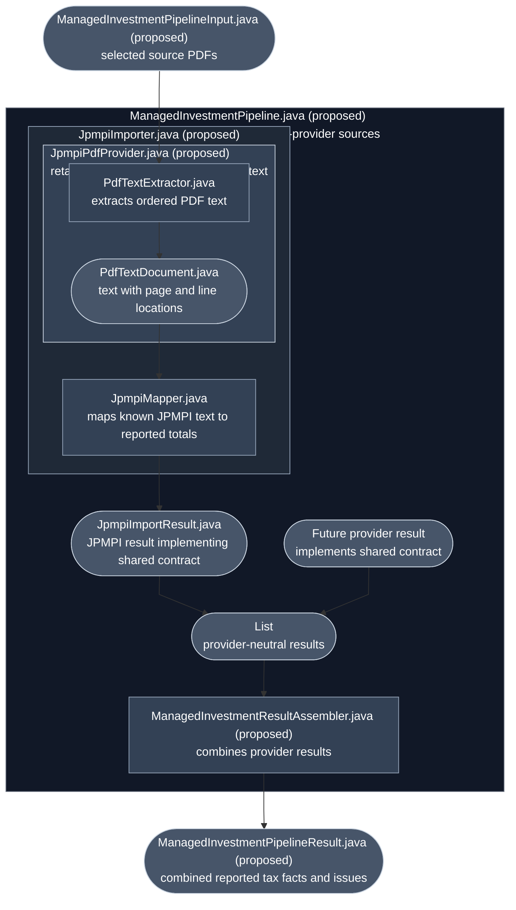
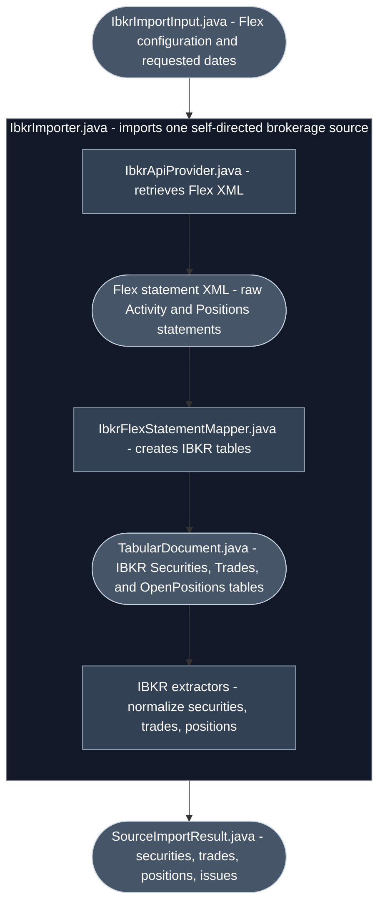
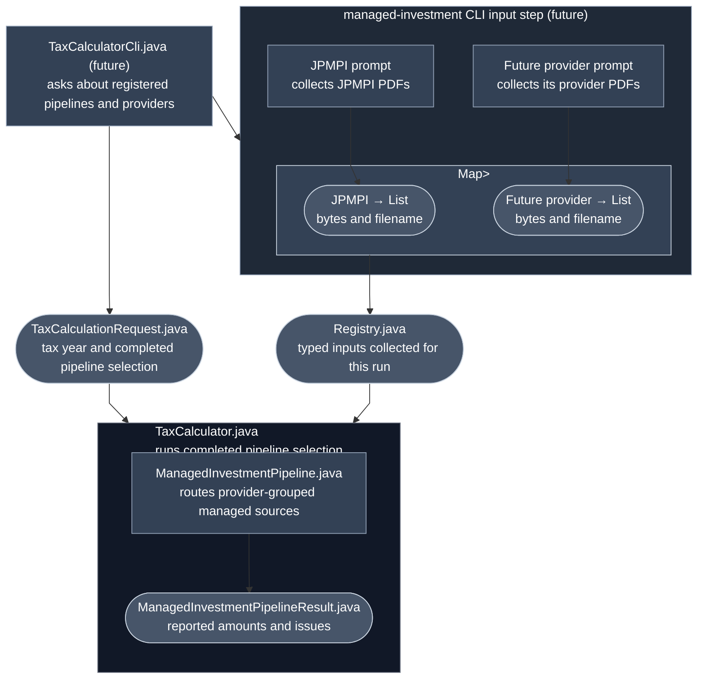

# Design: onboard managed investment

## Context

J.P. Morgan Personal Investing annual tax packs are the first managed-investment source. Other provider tax packs may follow. Bank/savings sources, manual entries, product access, exports, and storage remain separate work.

## Decisions

- Source-specific parsing stays separate from generic document mechanics and domain calculation.
- Generic PDF/table utilities do not contain bank-specific tax meaning.
- The two top-level domains are peer packages: `com.helper.pipeline.selfdirectedinvestment` contains IBKR-oriented source assembly and calculation preparation; `com.helper.pipeline.managedinvestment` contains managed-provider source handling.
- J.P. Morgan Personal Investing is a managed-investment source, distinct from the self-directed IBKR path. `ManagedInvestmentPipeline` owns loading one or more managed-provider sources during its run. For a JPMPI pack, it invokes `JpmpiImporter`, which obtains extracted text from `JpmpiPdfProvider` and asks one replaceable mapper to produce provider-reported UK and foreign interest, dividends, and final capital gain/loss with provider/account/tax-year provenance.
- `ManagedInvestmentSourceResult` is the provider-neutral result contract for one managed-provider source: stated tax year, final GBP amounts by `IncomeType`, and recoverable issues. `JpmpiImportResult` implements that contract while retaining its JPMPI-specific account and filename evidence. `ManagedInvestmentResultAssembler` accepts a list of the shared result interface and combines it into one `ManagedInvestmentPipelineResult`; it does not depend on JPMPI or another provider's concrete result class. A future provider implements the same contract. A provider/importer registry may later select an importer for a selected source type; that selection stays upstream of this assembler. The assembler does not parse PDFs, infer tax facts, or calculate CG from raw transactions. The managed path does not run raw-trade source assembly, security support resolution, ERI loading, holding-snapshot derivation, or local CG matching. `SelfDirectedInvestmentPipeline` uses `SelfDirectedInvestmentPipelineInput` and returns `SelfDirectedInvestmentPipelineResult`; `ManagedInvestmentPipeline` uses `ManagedInvestmentPipelineInput` and returns `ManagedInvestmentPipelineResult`. `TaxPipelineType.SELF_DIRECTED_INVESTMENT` selects `SelfDirectedInvestmentPipeline`; `TaxPipelineType.MANAGED_INVESTMENT` selects `ManagedInvestmentPipeline`. A run may select either or both types. There is no provider-total reconciliation between these paths: each retains its own source evidence, and duplicate-account detection is deferred to managed-source onboarding.

## JPMPI source ingestion design

## Self-directed IBKR extraction boundary

| Concern | Self-directed IBKR path | Managed JPMPI path |
| --- | --- | --- |
| Source artifact | Flex API XML statements | One annual non-ISA/pension source PDF |
| Provider parser boundary | `IbkrImporter` plus IBKR table extractors | `JpmpiImporter` owns `JpmpiPdfProvider` and a replaceable JPMPI source mapper |
| Extracted facts | Securities, raw trades, and positions | Provider-reported GBP totals by filing category, including the final capital gain/loss |
| Calculation ownership | The application derives dividend and later CG inputs | JPMPI supplies the tax categories and final CG total; the application preserves and aggregates them |
| Provenance | Account, source IDs, statement dates | Provider, account, tax year, and report filename |
| Validation | Required raw fields, requested coverage, holding/trade consistency | Provider/report identity, tax year, required sections, parsed-row totals against report totals |
| Recoverable outcome | Local source `Issue`, such as an unavailable Flex range | Local source `Issue` for a missing/ambiguous section or a total that does not reconcile; no guessed value |

Capital gains remain one `CapitalGainIncome` aggregate and one filing category for the current scope. UK CG rules calculate the taxable result by adding gains and deducting allowable losses across assets, so the JPMPI reported gain or loss combines with any self-directed result. The current filing output reports that combined total as capital gains; it does not create separate UK and foreign CG aggregates. A foreign capital-gain source still preserves its foreign origin, asset country, and foreign tax paid as evidence for a later filing handler, including any foreign-tax-credit or FIG treatment.

UK and foreign income are separate filing categories, not buckets within one aggregate. `IncomeAssembler` owns `UkDividendIncome`, `ForeignDividendIncome`, `UkSavingsIncome`, and `ForeignSavingsIncome`. Each concrete aggregate fixes its own `IncomeType`, so no caller can accidentally create a UK aggregate with a foreign category. `IncomeType` represents those four categories directly, so the existing single-value `IncomeResult` remains sufficient for each field. Every source passed to an aggregate supplies its calculated amount in GBP. A foreign source may perform FX selection upstream before it is added, but a provider-reported GBP source such as JPMPI is already final and must not be converted again. If a later tax rule needs a combined amount, it explicitly sums the relevant category results at that point.

`IssueCode` is an interface, not a central enum. Each code enum belongs to the component that creates the condition: for example, `IbkrIssueCode`, `JpmpiIssueCode`, `SecuritySupportIssueCode`, `EriIssueCode`, `SourceConsolidationIssueCode`, and `DividendIssueCode`. An `Issue` retains its original code while it propagates through later pipeline layers. The package and enum type supply the code grouping; `Issue` does not need a duplicated pipeline or stage field.

The caller gives a selected set of source PDFs to `ManagedInvestmentPipeline`; it returns one managed-investment pipeline result. The pipeline owns provider-specific importers and invokes `JpmpiImporter` for each JPMPI source. `JpmpiImportResult` implements `ManagedInvestmentSourceResult`, the shared per-source output that the pipeline passes to the assembler. Callers do not normally invoke an importer themselves.

`Pdf` is the shared immutable PDF-content value: bytes plus source filename. `JpmpiPdfProvider` is the JPMPI source-access boundary. Its input is one `Pdf`; its output is a `PdfTextDocument`, which contains extracted text with page and line locations. It delegates only PDF-to-text work to the reusable `PdfTextExtractor`; it does not know JPMPI tax categories.

`JpmpiMapper` is the current deterministic mapper. It accepts `PdfTextDocument`, identifies known JPMPI sections, validates the printed totals, and directly creates `JpmpiImportResult`. It has no file I/O and does not call `PdfTextExtractor` itself. A future `JpmpiApiMapper` would accept the same extracted text and return the same result type. There is no intermediate `TabularDocument` or provider-table model. A mapper must report a local `Issue` when the expected source document shape cannot be established. OCR is deferred: a scanned PDF without usable text is unsupported by the deterministic mapper until a separately scoped API/OCR mapper is introduced.

`TaxCalculationRequest` remains the calculation scope: tax year and selected pipeline types. It does not carry uploaded document bytes. A product adapter collects source documents before the calculation begins. The CLI reads a selected local path into bytes; a future UI receives uploaded bytes; a future Drive connector downloads bytes. Each adapter then creates the same `Pdf` from content and filename and puts one `ManagedInvestmentPipelineInput` in the run `Registry`. The core calculator, managed pipeline, and source input do not accept or depend on a filesystem path. `ManagedInvestmentPipelineInput` groups selected `Pdf` values under their provider type; each PDF itself contains only its bytes and source filename.

### CLI source collection

The current product entry point is a CLI. It collects the tax year, then asks about each registered top-level pipeline in turn. A pipeline is included only when the user confirms that they have input for it and completes that pipeline's input step. `TaxCalculator` remains the calculation coordinator: it receives the completed request and run `Registry`; it does not prompt for files. This keeps the calculation path reusable if a UI is added later.

The CLI presents each selected pipeline as one input step, then asks about each supported provider within that step. A provider prompt names the documents it understands and may collect zero, one, or many files. For example, managed investment asks “Do you have a JPMPI annual tax pack?” and, after a yes answer, repeatedly collects JPMPI PDFs. Once another managed provider is onboarded, it gets its own question such as “Do you have Provider B's annual statement?” and its own repeatable document step. A future savings pipeline follows the same pattern for each supported bank or platform.

The CLI does not pass one untyped global list of file paths downstream. It builds one typed input per selected pipeline and groups documents by provider: `Map<ManagedInvestmentProviderType, List<Pdf>>`. `Pdf` remains a generic document value containing only bytes and filename. The current `ManagedInvestmentPipelineInput` holds one ungrouped `List<Pdf>` because JPMPI is its sole supported provider. Before a second managed provider is added, it must evolve to this provider-keyed map. The managed pipeline uses each map key to select the matching importer for that provider's document list. The provider-specific CLI prompt and the importer registry use the same provider type, so a file is never sent to an importer chosen only by guesswork.

The later CLI adapter should follow this interaction:

1. Enter tax year.
2. For each registered pipeline, ask whether to include it in this run.
3. If included, collect its required input. A document-based pipeline repeatedly accepts source files until the user finishes that step. A pipeline with a default configuration, such as the current self-directed IBKR path, confirms that configuration instead.
4. Add only completed pipeline types to `TaxCalculationRequest` and put their typed inputs in the `Registry`.
5. Run `TaxCalculator` and print the combined result and issues.

For example, the managed-investment step begins with its registered provider prompts. If every answer is no, `MANAGED_INVESTMENT` is omitted from the request. If at least one provider source is supplied, the CLI adds `MANAGED_INVESTMENT` after that provider's document step completes. A future savings step follows the same pattern. This means the CLI's selected pipeline set is derived from completed input collection rather than selected independently in an earlier menu.

`TaxCalculatorFlow` is a fixed local POC, not a CLI design. It reads one JPMPI pack from `files/jpmci/tax-pack.pdf`, creates `Pdf(Path)` immediately, puts `ManagedInvestmentPipelineInput` in the run `Registry`, and runs both current top-level pipelines together. The `files/` directory is ignored by Git. `Pdf(Path)` stores only bytes and filename, so neither the managed pipeline nor `JpmpiImporter` receives a filesystem path. Provider discovery and repeatable multi-document CLI flow remain deferred work.

`TaxCalculatorCli` is the current product-facing layer. It discovers the registered top-level pipeline types and their provider prompts, then creates exactly one `TaxCalculationRequest` and one run `Registry`. `TaxCalculator` does not know JPMPI, Provider B, or file paths. It only selects the requested top-level pipeline factory. `ManagedInvestmentPipeline` receives provider-keyed document groups and chooses one matching importer for each map entry.

A future GUI does not run the CLI and does not execute `TaxCalculator` in the browser. Its screens present the same pipeline and provider choices, upload the selected files to a backend endpoint, and submit the selected tax year and provider tags. The backend adapter validates those uploads, builds the same `TaxCalculationRequest` and `Registry`, then calls `TaxCalculator`. The UI receives `TaxCalculationResult` and displays its income fields and issues. This lets the CLI and GUI share calculation and importer behavior while using interfaces suited to their users.

### Proposed JPMPI source result

`JpmpiImportResult` is the provider-specific typed result for one PDF. It implements `ManagedInvestmentSourceResult`, which exposes the tax year, recoverable issues, and `Map<IncomeType, BigDecimal>` provider-reported GBP totals needed by later generic stages. JPMPI-specific provider name, account ID, and report filename remain available on the concrete type as source evidence. The map includes the four filing categories and `CAPITAL_GAIN`, so the final capital gain or loss is handled exactly like the other reported totals. The mapper uses PDF page and line locations only while validating printed totals; detailed row locations are not propagated through the pipeline. The result is then ready for `ManagedInvestmentResultAssembler`; it is not a generic table that another class needs to reinterpret.

## Open Questions

D008 blocks snapshot storage. Source-specific formats and product-access scope must be selected before this broad change is implemented.
