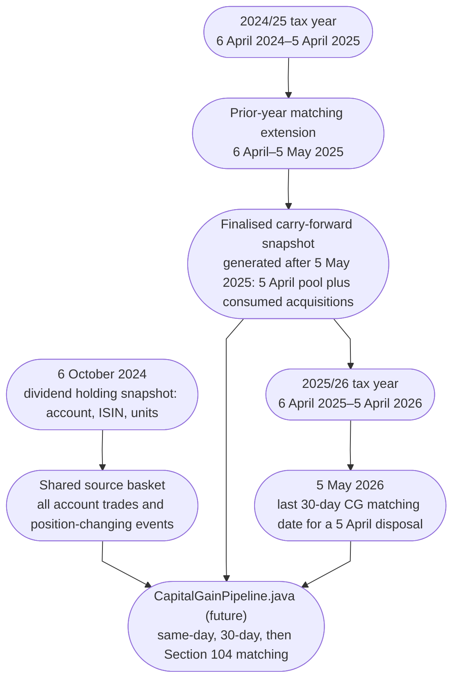

# Design: capital gains and multi-year state

## Context

Capital-gain inputs cover the tax year through 30 days after tax-year end. Existing domain logic performs same-day, 30-day, then pooled matching, but is not wired to source ingestion.

## Decisions

- Combine relevant taxable transactions before matching; preserve account provenance separately from pool ownership.
- Use explicit ERI adjustments, including explicit zero when appropriate.
- Persist/reload carry-forward snapshots without losing consumed acquisitions.
- Reuse the account-wide source basket imported for the full tax run. For 2025/26, its shared horizon is 6 October 2024–5 May 2026: this includes the dividend baseline and the 30 days following the tax-year end.
- Treat the CG opening snapshot as a Section 104 pool snapshot, not as a broker holding snapshot. Its pool quantity and pooled allowable cost are the state at the prior tax-year end (5 April), used to open the next tax year on 6 April.
- Finalise that opening snapshot only after the prior tax year's 30-day extension ends (5 May). It retains acquisitions in that extension that were consumed by prior-year disposals, so the next tax-year run can import those trades without pooling them again. It does not carry unresolved disposals forward.

## Shared import and snapshot timeline

The basket supplies normalised account facts. `CapitalGainPipeline` selects taxable transactions from 6 April 2025 through 5 May 2026 and combines them with the CG opening state. It does not use the dividend holding snapshot as a cost basis. A later acquisition within 30 days of a disposal has priority over the Section 104 pool, so the window must include the 30 days after tax-year end.

The 6 April–5 May overlap is deliberate. To finalise 2024/25, the system considers acquisitions through 5 May 2025 for disposals through 5 April 2025. It then generates a carry-forward snapshot whose Section 104 pool is logically the position at 5 April, plus a record of extension acquisitions already consumed by 2024/25 matching. The 2025/26 source basket still imports its ordinary trades from 6 April 2025. Before pooling them, the CG pipeline applies those consumed-acquisition records, preventing an acquisition from being used both for the earlier disposal and for the new year's pool.

For example, a 30 March 2025 disposal can match a 20 April 2025 acquisition. After 5 May, the 2024/25 carry-forward records that 20 April acquisition as consumed. The 2025/26 run imports that acquisition because it falls inside its tax year, but excludes its consumed quantity and cost from the 2025/26 Section 104 pool.

## Open Questions

D004 defines broker FX normalization. D007 defines pooling dispatch/ERI adjustment derivation. D008 defines snapshot storage. D010 defines cross-account coverage and reconciliation.
